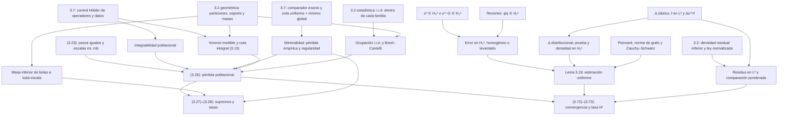

# Auditoría matemática independiente de la PR #18

## Dictamen

| Resultado | Dictamen |
|---|---|
| Teorema 3.8 | **Demostrado para residuos escalares con exponentes de masa 2 y 1.** `teorema38_dim2` concluye conjuntamente (3.26), (3.27) y (3.28) casi seguramente a partir del muestreo y de las hipótesis geométricas y variacionales. La formulación sobre clases abstractas permite recuperar la instancia neuronal escalar de dimensión dos al suministrar sus hipótesis y elegir los regularizadores de la tesis. El enunciado general en dimensión arbitraria y la variante unidimensional están fuera del alcance. |
| Teorema 3.20, homogéneo | **Demostrado para Poisson en `(-1,1)²` y candidatos `ψq` globalmente suaves.** La condición de frontera del candidato, su pertenencia a `H₀¹` y la identificación distribucional del residuo se prueban. Se obtiene (3.74), y se deducen (3.72) y (3.73) de la tasa poblacional demostrada en Lean. La solución exacta se da como un elemento de `H₀¹` que satisface la ecuación distribucional. |
| Teorema 3.20, levantamiento no homogéneo | **Demostrado en el mismo cuadrado para `G+ψq` con `G,q` globalmente suaves y `u*−G ∈ H₀¹`.** Se comprueba la igualdad puntual de frontera, la pertenencia del error a `H₀¹` y las mismas conclusiones energéticas y probabilísticas. La hipótesis afín sustituye el paso general por el núcleo del operador de trazas. |

No identifiqué un error matemático sustantivo en las declaraciones principales ni en las identificaciones que las conectan. Las diferencias relevantes para la revisión académica están en el alcance, la parametrización del funcional y el significado de la mensurabilidad. Las tres declaraciones integradas son condicionales a las hipótesis de existencia y selección que se indican abajo. En particular, la construcción neuronal manufacturada de la §3.14 de la tesis es un resultado separado.

## Base y método

La base auditada es el commit `cf182d9edde2a21d385193958ee7a880b996e865` de la [PR #18](https://github.com/MichaelMobius/tesispucp/pull/18), rama `codex/dirichlet-levantamiento-20261109`. Verifiqué que cada PR #4–#18 está basada en la revisión de cabeza de su predecesora. Las PR #3–#18 figuran como borradores sin fusionar. Comparé los blobs de los 22 módulos con los de su PR de origen en la pila. Todos coinciden con la cabeza de #18. Contrasté además los 22 módulos, el módulo raíz y los tres archivos de configuración con la copia local. En 15 archivos coincidió el hash de blob en bruto o con finales LF. En los otros 11 coincidió el texto tras normalizar BOM y finales de línea e ignorar el espacio final del archivo. Las referencias de código usan los nombres y líneas de esa revisión, relativos a `PUCP_PINN_Lean4/`.

La fuente de los enunciados, cotejados visualmente cuando la extracción textual perdía barras de clausura y formato de las potencias, fue el PDF `Tesis_PUCP_Revision_Ortotipografica_20261107-2.pdf`, SHA-256 `139e14ba44af83e0a02e9bd767e8f213f6800e74afc24287fb12454bfa356d0f`. Las páginas citadas son las impresas. Para las páginas de este capítulo, la posición en el archivo PDF es la página impresa más 13. Revisé las declaraciones, definiciones y los pasos de prueba que descargan las premisas críticas, junto con las fuentes fijadas de las bibliotecas.

## Matriz de correspondencia

| Tesis | Declaración Lean y ubicación | Hipótesis que entran | Conclusión, estado y límite |
|---|---|---|---|
| Hipótesis 3.2 y Lema 3.3, pp. 43–45, (3.4) | `CoberturaPINN.lean:76` (`MasaBolaSuperior`), `ConvergenciaUniforme.lean:21,37,126`, `Teorema38.lean:13,26` | Probabilidades concentradas, conjuntos medibles acotados, masa superior de bolas cerradas, particiones finitas medibles a toda escala pequeña, masa mínima y diámetro | Se obtiene la cota inferior de bolas abiertas a todo radio admisible. Los exponentes 2 y 1 representan el crecimiento de masa. La densidad de frontera y la independencia entre ambos muestreos quedan fuera de esta interfaz. |
| Lema 3.5, (3.13)–(3.14), pp. 51–58 | `VoronoiMedible.lean:17,25,39,50,76,86`, `CoberturaIntegral.lean:15,124,183,344` (`objetivoCoberturaIntegral_de_hipotesis`) | Muestras dentro de los soportes y cobertura por bolas cerradas, cota superior de masa, operadores y datos Hölder, integrabilidad | Demostrada la desigualdad determinista escalar en 2D. El desempate por índice mínimo admite puntos repetidos. El objetivo integral se obtiene de estas hipótesis. |
| Lema 3.6 y radios (3.5), pp. 48–49 y 58–60 | `OcupacionAleatoria.lean:125,156,255,287,301,377,405`, `TasaPoblacional.lean:41,59` | i.i.d. de cada familia, masa mínima por celda, diámetro y crecimiento eventual de muestras | Cálculo exacto de la probabilidad de una celda vacía, mayorante exponencial para el fallo y cobertura eventual casi segura. Radios proporcionales a `mr^(-1/4)` y `mb^(-1/2)`, sin pérdida logarítmica. |
| Hipótesis 3.7, (3.22)–(3.25), p. 64 | `VariacionalPINN.lean:50,65,75,85,135,144,160,185`, `CoberturaPINN.lean:85,102,108,112`, `Teorema38.lean:128` | Clases `Hm n`, selecciones mensurables, minimalidad global, comparador exacto y cota uniforme en un evento conull | El control empírico y de regularidad se prueba por comparación. Se reproducen los pesos iguales. Para recuperar el funcional literal hay que usar las seminormas exactas o justificar la equivalencia de minimizadores. |
| (3.26), pp. 66 y 68–70 | `CoberturaIntegral.lean:370`, `TasaPoblacional.lean:19,75,286,382`, `Teorema38.lean:128` | Cobertura, hipótesis variacionales, `mr(n) = O(mb(n)²)`, pesos fijos positivos | Cota determinista sobre cobertura a radios admisibles y `Loss = O(mr(n)^(-α/2))` eventualmente casi segura. La tasa se demuestra, sin introducirla como premisa en `teorema38_dim2`. |
| (3.27), pp. 66 y 70–72 | `ConvergenciaUniforme.lean:70,141,259,317`, `Teorema38.lean:128` | Cota de masa local inferior, regularidad deducida de la minimalidad y tasa poblacional | Ambos supremos puntuales de los valores absolutos tienden a cero casi seguramente. Son normas supremas de residuos escalares continuos y acotados en los soportes. En la tesis, la norma interior se escribe en `C⁰(Ū)`. |
| (3.28), pp. 67 y 70–72 | `ConvergenciaUniforme.lean:169,317`, `Teorema38.lean:128` | Las mismas que para (3.27) | Exponentes `−α²/[2(2α+2)]` y `−α²/[2(2α+1)]`, ambos respecto de `mr(n)`. Constantes finitas por realización, independientes de `n`. |
| Lema 3.19, (3.71), pp. 98–100 | `EnergiaSobolev.lean:30,58,83`, `LaplacianoDistribucional.lean:202,233,245`, `TransferenciaEnergetica.lean:17,48` | Abierto acotado de `ℝ²`, error en `H₀¹` y laplaciano distribucional en `L²` | Probada la estimación energética con un testigo de la forma `Cₚ√(1+Cₚ²)`. En el cuadrado se fija una constante común para todos los errores. La prueba no calcula la constante óptima. |
| (3.74), caso homogéneo, p. 101 | `RecorteCuadradoH01.lean:202`, `TransferenciaEnergetica.lean:81,98`, `PuentePoisson38_320.lean:24,60,75` | `h=ψq`, `q∈C∞(ℝ²)`, `u*∈H₀¹`, `Δu*=f∈L²` | Demostrado el error en `H₀¹` y la cota por el residuo `Δh−f` en `L²`. La condición de traza de la solución se representa por pertenencia directa a `H₀¹`. |
| (3.74), levantamiento, p. 101 | `DirichletLevantamiento.lean:39,60,71,82,93,113,165` | `h=G+ψq`, `G,q∈C∞(ℝ²)`, `u*−G∈H₀¹`, `Δu*=f∈L²` | Demostrada la cota por `Δh−f` en `L²`, aplicada dentro de `energia_de_perdidaLevantada`. La identificación general de traza con el núcleo `H₀¹` queda fuera de la prueba. |
| (3.72)–(3.73), pp. 101–102 | `PuentePoisson38_320.lean:170` (`teorema320_poisson_de_teorema38`), `DirichletLevantamiento.lean:203` (`teorema320_levantado_de_teorema38`) | La instancia correspondiente de (3.74), las premisas variacionales y estadísticas de (3.26) y densidad residual inferior positiva | En ambas clases se prueba convergencia casi segura en la norma `H¹` y tasa `O(mr(n)^(-α/4))`. Los dos teoremas invocan directamente `teorema38_dim2`. |
| Ruta alternativa (3.75), p. 102 | Ingredientes en `Teorema38.lean:128` y `TransferenciaEnergetica.lean:48` | Cota uniforme del residuo, volumen finito y error en `H₀¹` | La composición específica de esta ruta por la norma suprema queda fuera de las declaraciones integradas. Ambas prueban (3.72) mediante la ruta ponderada de (3.73), con la densidad inferior de la Hipótesis 3.2. |

## Grafo de dependencias de las pruebas principales

Las flechas van de la premisa o del resultado auxiliar a la declaración que lo utiliza. Las dos ramas se unen únicamente en el puente de Poisson.



### Trazabilidad por PR

| PR | Nodos verificados en código | Papel matemático |
|---|---|---|
| #3 | `Energia.lean:85,114`, `Minimalidad.lean:16,27`, `RedCuadratica.lean:15,20,25` | Álgebra de la estimación bajo Green y Poincaré, comparación escalar y tres identidades algebraicas de una red cuadrática. |
| #4 | `EnergiaSobolev.lean:30,68,76,83,107` | Descarga Poincaré e integra por densidad. Todavía recibe `HasTestLaplacian`. |
| #5 | `LaplacianoDistribucional.lean:24,36,54,113,202,222,245` | Descarga `HasTestLaplacian` a partir de la ecuación distribucional. La unicidad del residuo `L²` es independiente de la cota. |
| #6 | `DirichletCuadrado.lean:20,59,66,73,121` | Dominio abierto acotado, clase de pruebas y criterio de cierre. El teorema general de error exacto recibe la pertenencia a `H₀¹`. |
| #7 | `RecorteCuadrado.lean:154,261,317,350,443,525`, `RecorteCuadradoH01.lean:113,160,202,210` | Recortes interiores, cota uniforme del gradiente y convergencia de ambas componentes `L²`. `ψq∈H₀¹` queda probado sin soporte compacto de `q`. El teorema de estimación de esta etapa aún recibe la ecuación del residuo. |
| #8 | `ResiduoCuadrado.lean:43,80,110,132,173,184,211` | Identificación clásica y distribucional, pertenencia a `L²` y residuo de la diferencia. Para la solución exacta se mantiene su ecuación como premisa. |
| #9 | `TransferenciaEnergetica.lean:17,42,48,81,98,114,131,175` | Constante uniforme y transferencia determinista de convergencia y tasas. |
| #10 | `PerdidaPoblacional.lean:56,81,132,188,232,257` | Transferencia desde una pérdida dominante, con cota superior de densidad para integrabilidad universal. Las versiones probabilísticas de este módulo reciben la convergencia de la pérdida. |
| #11 | `DensidadResidualMinima.lean:21,46,65,87`, `VariacionalPINN.lean:135,144,160,185`, `CoberturaPINN.lean:23,129` | Variante con integrabilidad ponderada en lugar de densidad superior. Funcional variacional, comparación y control puntual de cobertura. |
| #12 | `VoronoiMedible.lean:17,50,76,86`, `CoberturaIntegral.lean:124,344,370` | Construye y usa la partición medible. Descarga el objetivo de (3.13) y lo aplica al minimizador. |
| #13 | `OcupacionAleatoria.lean:63,125,255,301,377,405` | Fallos sumables y cobertura eventual casi segura para dos familias. |
| #14 | `TasaPoblacional.lean:19,75,142,154,219,272,286,382,590` | Prefijos muestrales, pertenencia al soporte, integrabilidad, cancelación de factores y derivación de (3.26). |
| #15 | `ConvergenciaUniforme.lean:37,141,169,259,292,317` | Interpolación cuantitativa a partir de masa local y pérdida, y mensurabilidad condicional de la pérdida. |
| #16 | `Teorema38.lean:13,26,34,61,128,263,277,311` | Usa una sola familia muestral, especializa particiones de todas las escalas y obtiene conjuntamente las tres conclusiones. Separa la mensurabilidad de los observables. |
| #17 | `PuentePoisson38_320.lean:16,24,51,69,84,107,127,170` | Poisson homogéneo exacto, comparación energética con la pérdida, tasa y convergencia casi seguras. |
| #18 | `DirichletLevantamiento.lean:27,39,60,71,82,113,137,165,192,203,295,307` | Caso afín con levantamiento suave, operador de frontera real y evento exacto de convergencia bajo mensurabilidad del grafo. |

## Hipótesis y cuantificadores del Teorema 3.8

**Hipótesis 3.2.** La tesis exige un dominio euclidiano Lipschitz acotado y una parte cerrada de su frontera, probabilidades absolutamente continuas respecto del volumen y de la medida de Hausdorff correspondiente, densidades inferiores positivas y dos familias i.i.d. independientes entre sí. `DatosMasa38` y `Muestreo38` (`Teorema38.lean:13,26`) retienen concentración, mensurabilidad del soporte, masa superior, particiones con masa mínima y diámetro, y leyes e independencia interna de cada familia. Los dos conjuntos pueden estar en espacios pseudométricos diferentes. En consecuencia, la interfaz es **más débil** en geometría, densidades y acoplamiento entre familias. La prueba intersecta dos eventos conull y no necesita independencia entre las familias. En los puentes energéticos se reincorpora la densidad interior porque allí sí se necesita para la comparación con Lebesgue.

**Particiones y escalas.** `ParticionesMinimas` (`ConvergenciaUniforme.lean:21`) exige celdas disjuntas, medibles y que cubran el soporte a toda escala pequeña. Esto coincide con la lectura usual de «partición» de la Hipótesis 3.2. El Lema 3.6 permite disjunción salvo conjuntos nulos, una formulación ligeramente más débil. Para una familia finita medible con unión igual al soporte, restar de cada celda las anteriores preserva su masa, su inclusión y su cota de diámetro. Esa conversión no está empaquetada en Lean. `Teorema38.lean:177–221` escoge las particiones discretas requeridas por ocupación a partir de las disponibles a todas las escalas en una cola determinista. Para una bola abierta de radio `r`, se usa la celda de escala `r/(2√2)`, contenida en la bola por tener diámetro a lo sumo `r/2` (`ConvergenciaUniforme.lean:37`). La no degeneración local es una conclusión, sin una premisa adicional de densidad.

**Índices y probabilidad.** `problemaMuestral` usa exactamente los prefijos de longitud `mr(n)` y `mb(n)` (`TasaPoblacional.lean:142`). Esto formaliza el acoplamiento ejemplificado en la tesis. Un arreglo de muestras distinto en cada fila sobre el mismo espacio sería una interfaz más general. El cálculo por fila y Borel–Cantelli no requieren independencia entre índices `n`. La concentración y las leyes de las muestras dan pertenencia simultánea casi segura al soporte (`TasaPoblacional.lean:154`). `teorema38_dim2` supone tamaños estrictamente positivos en todos los índices para normalizar los promedios. Un prefijo finito se puede descartar para las conclusiones asintóticas. Las hipótesis de crecimiento eventual y comparabilidad conservan los tres índices. La familia `Hm n` puede distinguir índices con idéntico par de tamaños, mientras la tesis indexa por el par.

**Pérdida y pesos.** `ProblemaPINN` separa promedio empírico, integral poblacional y funcional regularizado (`VariacionalPINN.lean:50–87`). `C_m = 3 max(Cr·mr·εr²,Cb·mb·εb)` y `a_m = max(3λrεr^(2α)/C_m,3λbεb^(2α)/C_m)`, con pesos empíricos `λr,λb` positivos y fijos. `TasaPoblacional.lean:19` prueba la identidad de `C_m a_m` con el denominador positivo. Las celdas de masa al menos `m^(-1/2)` dan a lo sumo `√m` celdas y probabilidad de fallo a lo sumo `√m exp(−√m)`. Esta relaja la cota binomial de la tesis y sigue siendo sumable para los tamaños considerados (`OcupacionAleatoria.lean:45,63,255,301`). Con `εr ∝ mr^(-1/4)` y `εb ∝ mb^(-1/2)`, elevar a `2α` da los órdenes `mr^(-α/2)` y `mb^(-α)`. La comparabilidad permite absorber el segundo en el primero (`TasaPoblacional.lean:59,75`). Los factores 3 de (3.13) multiplican también los términos separados de los datos.

**Hipótesis 3.7.** Lean cuantifica sobre clases funcionales abstractas y operadores escalares, sin pedir una red, un espacio de parámetros o la regularidad `C^{k,α}(Ū)` del candidato abstracto. Sí pide cotas Hölder sobre ambos operadores para todos los candidatos y sobre ambos datos. En `Teorema38.lean:128–160` las selecciones toman valores en `Hm n` para todo `ω`. Sobre un conjunto conull hay un `R(ω)` finito que controla la regularidad del comparador para todos los índices, junto con interpolación exacta y minimalidad. Esto recupera el contenido variacional y probabilístico de la tesis para el funcional elegido. La pertenencia a la clase y la mensurabilidad de las selecciones se suministran. La cota de regularidad del minimizador se deduce de la comparación y de `a_m>0` (`VariacionalPINN.lean:160`, `ConvergenciaUniforme.lean:259`, `Teorema38.lean:235–253`). La existencia de los minimizadores y comparadores de la clase neuronal manufacturada de §3.14, su mensurabilidad en una estructura natural y la interpretación de los entrenamientos del capítulo IV requieren una instancia adicional.

**Seminormas exactas frente a cotas.** En `VariacionalPINN.lean:75,78` se cuadran los campos `seminormaL` y `seminormaB`. `CotasHolder` solo exige que sean cotas no negativas de los cocientes Hölder. Esto permite implementar la variante con mayorantes comentada en §3.3, p. 48. Para una cota dependiente del candidato, el funcional puede cambiar su conjunto de minimizadores. Tampoco se transmite automáticamente una cota uniforme de las seminormas exactas a mayorantes arbitrarios. La identificación literal de (3.22)–(3.25) se obtiene al elegir los campos como las seminormas exactas y verificar las hipótesis variacionales para esa elección. La prueba es válida para cualquier otra elección con sus propios minimizadores y comparadores.

**Conclusiones.** La desigualdad bajo cobertura y la conclusión casi segura se prueban en niveles separados. `teorema38_dim2` empaqueta la versión asintótica casi segura de (3.26) con (3.27) y (3.28). El `BigO` está dentro del cuantificador casi seguro, por lo que su constante puede depender de `ω`. `supResiduo` es el supremo puntual del valor absoluto en el soporte, con cero añadido (`ConvergenciaUniforme.lean:111`). El control Hölder garantiza que representa la norma suprema. En el caso euclidiano, el residuo se extiende de forma única y continua a `Ū` por continuidad uniforme. Su supremo no cambia, por densidad de `U` en `Ū`. La tesis formula (3.27) y (3.28) en `C⁰(Ū)`. Lean prueba la cota del supremo sobre `U` y no construye la extensión como objeto de ese espacio. La prueba usa radios truncados y, para la tasa, radios ajustados al orden de la integral (`ConvergenciaUniforme.lean:141,169`). Recupera las conclusiones de la tesis sin declarar la desigualdad general de interpolación (3.34) en su forma literal.

## Teorema 3.20

**Espacio funcional.** El tipo ambiente `H1Graph` de EllipticPDE es el producto `L² × L²` con norma cuadrática. El subespacio `W12` impone la relación de derivada débil. `H01` es la clausura de los grafos de funciones de prueba y está contenido en `W12`. El código identifica ambas componentes del grafo de `ψq` con la función y su gradiente clásicos casi en todas partes (`RecorteCuadradoH01.lean:99–112`). Los recortes se estabilizan localmente y sus gradientes están uniformemente acotados, porque `ψ=O(δ)` en la franja donde `Dχδ=O(1/δ)`. La convergencia en `L²` de las dos componentes prueba la pertenencia a `H01` (`RecorteCuadradoH01.lean:113,160,202`). En el caso afín, el grafo de `G` pertenece a `W12` por el teorema de derivada débil de una función suave. El grafo del candidato pertenece a `W12` por suma, al igual que el de `u*` por la premisa `u*−G ∈ H01` (`DirichletLevantamiento.lean:39,57,60,82`). La convergencia en el grafo es por tanto convergencia en la norma completa de Sobolev.

**Traza y alcance.** `PuentePoisson38_320.lean:24,60` demuestra que la evaluación de `ψq` se anula en toda la frontera topológica. `DirichletLevantamiento.lean:71` demuestra que `G+ψq` coincide con `G` allí. Para la solución exacta se pide `u*∈H₀¹` o `u*−G∈H₀¹` directamente, sin exigirle un representante continuo. Sobre un dominio Lipschitz, la identificación con una traza prescrita usa el teorema del núcleo de la traza, citado en la p. 101 de la tesis. Esa identificación no se formaliza aquí. La tesis exige `C⁰(Ū)` para la solución y los aproximantes. Su igualdad puntual en toda la frontera es compatible con la igualdad de trazas usada en su demostración. Las hipótesis Lean son más restrictivas en dominio y clase de candidatos, y prescinden de continuidad puntual de la solución. El caso de frontera penalizada, los datos sin levantamiento globalmente suave y las clases afines Sobolev generales quedan fuera de estas dos declaraciones.

**Signos y representantes.** `LaplacianoDistribucional.lean:24,36,54,113,202` define el laplaciano como suma de segundas derivadas en una base ortonormal y obtiene `⟨∇e,∇φ⟩ = −⟨Δe,φ⟩`. La identidad de Green se extiende al propio error por densidad (`EnergiaSobolev.lean:83`). `ResiduoCuadrado.lean:43,80,110,127,132` enlaza el laplaciano de Mathlib, el clásico y el distribucional, con una clase `L²` sobre el cuadrado. `datoPoissonLp_ae` identifica el dato puntual con el representante `L²`. `residuoPoisson_ae` y `residuoLevantado_ae` identifican `Δh−f`, y la igualdad distribucional del error se obtiene por linealidad (`PuentePoisson38_320.lean:69,75`, `TransferenciaEnergetica.lean:81`, `DirichletLevantamiento.lean:93,113`). La tesis escribe el error `u*−h` y el residuo `f−Δh`. Lean invierte ambos en la misma ecuación. La igualdad de normas bajo cambio de signo preserva (3.74).

**Constante y densidad.** `EnergiaSobolev.lean:30` obtiene una constante positiva de Poincaré mediante `√(C+1)` a partir de la cota cuadrática de EllipticPDE. `TransferenciaEnergetica.lean:17–48` elige una constante uniforme antes de cuantificar sobre el error y su residuo. El testigo de existencia se construye como `Cₚ√(1+Cₚ²)`. La constante pública `constanteEnergiaCuadrado` se obtiene por elección y la API expone positividad y la cota, sin valor numérico. `DensidadInferior` (`DensidadResidualMinima.lean:21`) requiere una densidad real medible con cota inferior positiva casi en todas partes para el volumen restringido al cuadrado. La no negatividad se deduce en ese mismo sentido. La ley residual se define con `withDensity` respecto del volumen **restringido** (`PuentePoisson38_320.lean:72`). Su normalización a probabilidad es una premisa expresa de las instancias integradas. La cota superior de densidad del módulo intermedio `PerdidaPoblacional` no se requiere en las instancias finales. La integrabilidad ponderada se conserva como premisa en las comparaciones aisladas y se demuestra en los puentes integrados por Hölder, acotación, concentración y finitud de las medidas (`TasaPoblacional.lean:219,272`, `PuentePoisson38_320.lean:222–250`, `DirichletLevantamiento.lean:253–280`). De este modo la comparación usa integrales finitas de residuos al cuadrado. La representación de la medida de frontera en Lean pide una probabilidad concentrada con los controles de masa. Puede instanciarse con la ley de la tesis, pero el puente no utiliza su densidad de Hausdorff.

**Transferencia.** En las dos instancias el término de frontera de la pérdida se anula en virtud de la igualdad evaluada y la concentración de la medida. La comparación da `‖h−u*‖H¹ ≤ K_E (ρ₀λr)^(-1/2) √Loss(h)`, con constante determinista independiente de `ω` y `n`. `transferencia_energiaPoisson_ae` (`PuentePoisson38_320.lean:127`) convierte (3.26) en la tasa `−α/4` por la raíz y obtiene convergencia porque `mr(n)→∞`. El exponente de (3.73) en dimensión dos coincide exactamente. La constante implícita de la tasa puede depender de la realización por la constante de (3.26).

### El significado exacto de `SG`

`operadoresLevantados` fija `B(q)(x)=(G+ψq)(x)`, `g(x)=G(x)` y `seminormaB(q)=SG` (`DirichletLevantamiento.lean:192–200`). La premisa `CotasHolder` usa `SG` también para el dato (`DirichletLevantamiento.lean:231`). Por la igualdad probada sobre `Γ`, se exige una cota común válida para la función `G|Γ`. Si el dato es no constante, `SG=0` incumple esta premisa. Tal cota finita existe matemáticamente para el levantamiento suave, porque su gradiente está acotado en el cuadrado cerrado convexo y `0<α≤1`. La declaración recibe la cota elegida dentro de `CotasHolder`.

La seminorma exacta de todo candidato sobre `Γ` vale `[G|Γ]α`. Por tanto, manteniendo fijo el regularizador interior, el cambio en el funcional regularizado para cada `n` es

```text
J_SG(q) − J_exacto(q) = a_m (SG² − [G|Γ]α²).
```

El término es independiente de `q`. Conserva los minimizadores sobre la misma clase y la interpolación de la pérdida empírica. El total de regularidad de cada comparador cambia por una cantidad fija y finita, compatible con la cota uniforme. Los valores del funcional coinciden si se elige la seminorma exacta. Esta equivalencia de minimizadores es una comprobación matemática de la auditoría y no figura como lema de Lean. No se extiende a una sustitución arbitraria de `seminormaL` dependiente de `q`.

## Mensurabilidad

| Objeto | Qué demuestra el código | Qué se suministra o queda por instanciar |
|---|---|---|
| Selecciones de minimizador y comparador | `teorema38_dim2` y sus puentes las reciben como funciones con valores en la clase. La prueba de (3.26) usa minimalidad e interpolación sobre un conjunto conull. | `Measurable` de ambas selecciones hacia un espacio medible de candidatos. La estructura medible es un parámetro. Se debe identificar con una estructura natural para una instancia neuronal concreta. |
| Ocupación y cobertura | Los eventos de ocupación son finitos y medibles (`OcupacionAleatoria.lean:116,182,193`). Borel–Cantelli produce ocupación eventual casi segura. Ocupación implica cobertura (`:287,301,310`). | La prueba no necesita la mensurabilidad del conjunto exacto definido por «todo punto del soporte está cubierto». |
| Pérdida poblacional por índice | `measurable_perdidaPoblacional_seleccion` y `measurable_perdida_problemaMuestral` prueban mensurabilidad por integración paramétrica (`ConvergenciaUniforme.lean:292`, `Teorema38.lean:263`). Con pérdidas medibles, la cota eventual de (3.26) admite evento exacto medible de probabilidad uno (`TasaPoblacional.lean:590,630`). | Los mapas de evaluación de `L,B` deben ser conjuntamente medibles en candidato y punto, los datos medibles y la selección medible. La continuidad espacial de cada trayectoria sirve para integrabilidad espacial y no garantiza por sí sola la dependencia medible en `ω`. |
| Supremos de (3.27)–(3.28) | `measurable_supResiduo_de_denso` reduce a un supremo numerable de evaluaciones y `prob_uno_convergencia_sup` obtiene el evento exacto de (3.27) (`Teorema38.lean:277,311`). | Enumeración densa del soporte, continuidad y acotación de las trayectorias, y evaluaciones medibles. Los soportes euclidianos de Poisson admiten tal enumeración. Los eventos exactos de cada `BigO` de (3.28) no están empaquetados, aunque bajo esas mensurabilidades se expresan mediante umbrales enteros y operaciones numerables. |
| Mapa a `H1Graph` | `measurable_grafoLevantado` transporta la mensurabilidad por traslación continua en la estructura de Borel (`DirichletLevantamiento.lean:295`). `prob_uno_convergenciaLevantada` mide el evento exacto de (3.72) mediante las normas reales (`:307`). | Se recibe la mensurabilidad del grafo homogéneo para cada índice. La mera selección mensurable en un espacio arbitrario de candidatos no la descarga. Un espacio natural de parámetros con dependencia continua del valor y del gradiente sobre el cuadrado cerrado sería una manera de verificarla. |

En las declaraciones integradas, `∀ᵐ ω ∂P` significa que el complemento tiene medida exterior cero. Esto garantiza un subconjunto medible conull donde las propiedades se cumplen conjuntamente. Para pedir además la mensurabilidad del **conjunto exacto** de realizaciones en la σ-álgebra original, se aplican los lemas separados con sus respectivas condiciones. En la completación de la medida, todo subconjunto de un conjunto nulo es medible. En particular, la conclusión casi segura de las declaraciones principales ya está demostrada, y su validez no depende de considerar medible un supremo no numerable.

## Bibliotecas y verificación

- **Lean y dependencias fijadas.** Lean `v4.35.0`, Mathlib `v4.35.0` en `56a005855ea17e0b0958f73ec801ae140b0a1679` y EllipticPDE en `c47acceaf985f59e1cf3257ffea077a73ea99dae`. Contrasté `lean-toolchain`, `lakefile.toml`, `lake-manifest.json` y los commits locales de ambas dependencias.
- **EllipticPDE.** `EllipticPdes/Sobolev/Graph.lean:55,107,392,396,519,560` contiene el espacio ambiente, la identidad de norma, los subespacios y la equivalencia con derivada débil. `EllipticPdes/Sobolev/WeakDeriv.lean:367` aporta la derivada débil de una función diferenciable en el abierto. `EllipticPdes/Poincare/GraphBounded.lean:92` requiere el espacio euclidiano finito dimensional no trivial y la medida de Haar, además de acotación. Estas condiciones se satisfacen con el plano y volumen. La prueba de Poincaré no supone una traza ni una constante específica del cuadrado.
- **Mathlib.** `Mathlib/Analysis/Distribution/Distribution.lean:303,307,373` define `ofFun`, prueba su acción por integración bajo integrabilidad local y su inyectividad bajo integrabilidad local hasta igualdad casi en todas partes. El código descarga la integrabilidad local de los representantes `Lp` antes de usar esos resultados (`LaplacianoDistribucional.lean:202–231`). La identidad clásica y la distribución usan la misma base ortonormal (`ResiduoCuadrado.lean:43–97`). `Mathlib/MeasureTheory/OuterMeasure/BorelCantelli.lean:92` requiere sumabilidad de las medidas de fallo, demostrada en `OcupacionAleatoria.lean:327,346`. La integración paramétrica y el evento exacto de convergencia usan `Mathlib/MeasureTheory/Integral/Prod.lean:74` y `Mathlib/MeasureTheory/Constructions/Polish/Basic.lean:985`, respectivamente. Las premisas topológicas y medibles se identifican arriba.
- **Compilación y axiomas.** Las 16 revisiones de cabeza tienen CI exitosa. La CI de #18 ejecutó `lake build` y registró 3 228 tareas. Repetí `lake build` en la copia local con la caché disponible. Terminó correctamente con 3 228 tareas y reprodujo las 161 salidas de axiomas. El registro de CI contiene 161 salidas de `#print axioms`. Todas listan solo `propext`, `Classical.choice` y `Quot.sound`. Entre ellas están las tres declaraciones integradas, la identidad de Green, la energía uniforme, la cobertura y los puentes de mensurabilidad. La búsqueda de `sorry`, `admit` y declaraciones `axiom` en las fuentes propias quedó vacía y el registro no contiene `sorryAx`. La auditoría de las hipótesis es independiente de este resultado. [CI de la PR #18](https://github.com/MichaelMobius/tesispucp/actions/runs/42765325611)

| PR | Cabeza | CI exitosa |
|---|---|---|
| #3 | `cee536a79966` | [42539719543](https://github.com/MichaelMobius/tesispucp/actions/runs/42539719543) |
| #4 | `a78ea04a7834` | [42542650429](https://github.com/MichaelMobius/tesispucp/actions/runs/42542650429) |
| #5 | `2cda6715ff98` | [42546968646](https://github.com/MichaelMobius/tesispucp/actions/runs/42546968646) |
| #6 | `bfafaed3aa79` | [42548915707](https://github.com/MichaelMobius/tesispucp/actions/runs/42548915707) |
| #7 | `d859e1fe3cb1` | [42555346514](https://github.com/MichaelMobius/tesispucp/actions/runs/42555346514) |
| #8 | `b66203bc86f3` | [42557549377](https://github.com/MichaelMobius/tesispucp/actions/runs/42557549377) |
| #9 | `07ec55581276` | [42561412158](https://github.com/MichaelMobius/tesispucp/actions/runs/42561412158) |
| #10 | `b99f755dbf29` | [42563587808](https://github.com/MichaelMobius/tesispucp/actions/runs/42563587808) |
| #11 | `bcf0d904c11b` | [42635347971](https://github.com/MichaelMobius/tesispucp/actions/runs/42635347971) |
| #12 | `efdb2f0c9990` | [42641818664](https://github.com/MichaelMobius/tesispucp/actions/runs/42641818664) |
| #13 | `31fe73879ae1` | [42669417668](https://github.com/MichaelMobius/tesispucp/actions/runs/42669417668) |
| #14 | `db1da9b9d5aa` | [42678626610](https://github.com/MichaelMobius/tesispucp/actions/runs/42678626610) |
| #15 | `fb689461ab78` | [42722153796](https://github.com/MichaelMobius/tesispucp/actions/runs/42722153796) |
| #16 | `c67d314e6ab2` | [42725517983](https://github.com/MichaelMobius/tesispucp/actions/runs/42725517983) |
| #17 | `fe11b5c2d7ac` | [42727961044](https://github.com/MichaelMobius/tesispucp/actions/runs/42727961044) |
| #18 | `cf182d9edde2` | [42765325611](https://github.com/MichaelMobius/tesispucp/actions/runs/42765325611) |

## Hallazgos y prioridades

| Prioridad | Clasificación | Hallazgo y acción indispensable |
|---|---|---|
| 1 | Discrepancia de hipótesis y alcance | En la versión para revisión académica, declarar el alcance escalar de 3.8 en dimensión dos y las dos clases suaves del cuadrado para 3.20. Identificar la condición de traza representada directamente por `H₀¹` y el carácter condicional de la instancia neuronal. Si se pretende certificar el 3.20 literal para dominios Lipschitz y clases afines generales, la obligación central es formalizar el puente de trazas y ampliar los dominios y dimensiones. |
| 2 | Discrepancia de interpretación del funcional | Indicar qué seminormas se instancian exactamente y cuándo se usan cotas. Registrar la equivalencia de argmin para `SG` fijo. Si se afirma identidad con (3.22) para una clase concreta, basta elegir las seminormas exactas o justificar la equivalencia de sus minimizadores. |
| 3 | Problema de interpretación probabilística | Distinguir las conclusiones `∀ᵐ` ya probadas de la mensurabilidad del evento exacto en la σ-álgebra original. Para afirmar esta última en una instancia concreta, especificar la σ-álgebra de candidatos y verificar la mensurabilidad de las evaluaciones y del grafo pertinente. |
| 4 | Mejora documental | El comentario de `ObjetivoCoberturaIntegral` en `CoberturaPINN.lean:126` conserva el estado anterior a la PR #12. La demostración sí existe en `CoberturaIntegral.lean:344`. La aclaración puede incorporarse a las notas de la versión estable. |

Recomiendo detener la expansión del código y preparar una versión estable de la pila #3–#18 para revisión académica, con este alcance explícito. Solo reabriría la formalización si la revisión exige el enunciado general con trazas o la certificación de una clase neuronal concreta. Esta auditoría entrega el informe como único archivo nuevo y conserva el PDF, las pruebas y la pila de PR.
