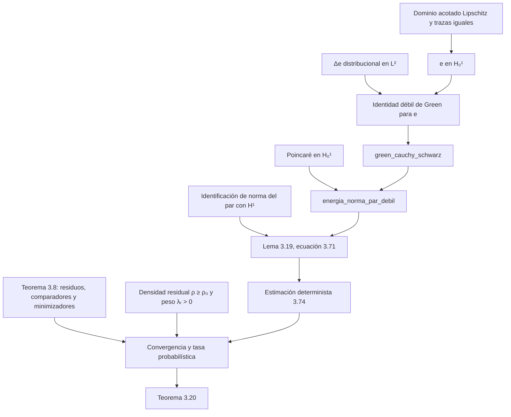

# Informe de compilación y diagnóstico — 8 de noviembre de 2026

## Alcance comprobado

Se inspeccionaron los tres módulos Lean del ZIP inicial, el módulo raíz, la configuración de Lake y los enunciados pertinentes de la tesis (PDF, páginas 79-80, 111-115 y 125-126; paginación impresa 66-67, 98-102 y 112-113). El ZIP no contenía historial Git. El manifiesto `MANIFEST_SHA256.json` conserva las sumas del **ZIP de entrada**; no describe los archivos modificados.

## Entorno y comandos

- Sistema: Windows; la instalación temporal de elan se colocó en `D:\PUCP_PINN_Lean4\.tooling\elan` porque C: no disponía de espacio suficiente.
- `lean-toolchain`: `leanprover/lean4:v4.35.0`. `lean --version`: Lean 4.35.0, commit `eb6cafb7290e8bd5f2937522d8d804f58f02bafc`.
- `lakefile.toml`: Mathlib `v4.35.0`. `lake-manifest.json`: commit `56a005855ea17e0b0958f73ec801ae140b0a1679`.
- `lake update`: éxito (código 0), tras completar la caché. La primera instalación en C: falló por espacio insuficiente; un primer postprocesado de caché se interrumpió tras descargarse los archivos y luego se reintentó.
- `lake exe cache get`: éxito (código 0); 9031 archivos ya descomprimidos.
- `lake build`: éxito (código 0), 2488 trabajos, después de las correcciones y de añadir los tres lemas de energía.
- Se ejecutó `#print axioms` en las once declaraciones. Todas reportaron únicamente `[propext, Classical.choice, Quot.sound]`. Ninguna reportó `sorryAx`. La búsqueda en los módulos no encontró declaraciones `axiom`, `sorry` ni `admit`.

La compilación produce advertencias informativas sobre el uso del sistema de módulos de Mathlib y una variable `he` no referida explícitamente en `gradiente_controlado`; no son errores de compilación.

## Errores corregidos

La primera compilación detectó que `(mul_le_mul_left h).mp/.mpr` y `(mul_le_mul_right h).mp` ya no son las equivalencias apropiadas en esta versión. Se sustituyeron por `mul_le_mul_iff_of_pos_left/right` sin cambiar los enunciados. Los imports globales `Mathlib` se limitaron a los módulos efectivamente utilizados. Se corrigieron durante la elaboración de los nuevos lemas la sintaxis del producto interno, el uso de `WithLp.toLp` y la desigualdad `-x ≤ |x|`.

## Clasificación lógica

| Declaración Lean | Correspondencia con la tesis | Estado |
|---|---|---|
| `regularidad_controlada`, `perdida_empirica_controlada` | Dos pasos algebraicos de la prueba del Teorema 3.8 | Compiladas, demostradas condicionalmente a la desigualdad del comparador y no negatividad; no formalizan el teorema probabilístico |
| `gradiente_controlado`, `error_l2_controlado`, `energia_cuadratica_controlada` | Pasos numéricos del Lema 3.19, usados en Teorema 3.20 | Compiladas, condicionadas por `hGreen` y `hPoincare` |
| `green_cauchy_schwarz` | Identidad débil de Green + Cauchy–Schwarz del Lema 3.19 | Compilada, condicionada por `hWeak` entre elementos de espacios con producto interno |
| `energia_cuadratica_debil`, `energia_norma_par_debil` | Cota cuadrática y coeficiente `Cₚ√(1+Cₚ²)` de (3.71) | Compiladas, condicionadas por `hWeak` y `hPoincare`; la norma es la del par hilbertiano `(e,g)`, aún no la de una función Sobolev |
| `decodificar_registro`, `multiplicacion_cuadratica`, `factor_frontera` | Identidades empleadas en el Lema 3.24 | Compiladas como identidades algebraicas; arquitectura común pendiente |

Ninguno de los teoremas 3.8, 3.20 o Lema 3.24 está formalizado por completo. También quedan pendientes los Teoremas 3.4 y 3.18, la Proposición 3.15, la Proposición 3.25 y el Corolario 3.26.

## Mapa de dependencias para la meta de Poisson

**Formalizado aquí:** los nodos `green_cauchy_schwarz` y `energia_norma_par_debil`, además de sus pasos algebraicos. **Pendiente:** construir los demás nodos y las flechas analíticas/probabilísticas en tipos concretos, sin tratarlas como axiomas.

## EllipticPDE de Soto Franco y Marshall-Stevens

La biblioteca [EllipticPDE](https://github.com/alejandro-soto-franco/EllipticPDE) ofrece `H1Graph.H01`, `H1Graph.norm_sq_eq` en [`Sobolev/Graph.lean`](https://github.com/alejandro-soto-franco/EllipticPDE/blob/main/lean/EllipticPdes/Sobolev/Graph.lean) y `H1Graph.poincare_H01_of_bounded` en [`Poincare/GraphBounded.lean`](https://github.com/alejandro-soto-franco/EllipticPDE/blob/main/lean/EllipticPdes/Poincare/GraphBounded.lean). Su teorema de Poincaré entrega una constante `C ≥ 0` para la **desigualdad cuadrática** `‖fnL U‖² ≤ C‖gradL U‖²`; habrá que convertirla cuidadosamente a la convención `Cₚ > 0` de la tesis.

La rama principal de EllipticPDE fija Lean y Mathlib `v4.35.0-rc3`, mientras este proyecto usa `v4.35.0`. No se añadió aún como dependencia porque no se ha comprobado una compilación conjunta. Además, su `H01` se define como cierre de grafos de funciones de prueba; para identificarlo con el núcleo del operador traza en un dominio Lipschitz se requiere un puente adicional. La biblioteca trabaja con elementos del grafo y una formulación débil en forma de divergencia; la tesis formula `Δe` distribucional y traza exacta. Esa traducción también está pendiente.

## Próximos pasos verificables

1. Fijar una revisión compatible de EllipticPDE o adaptar su versión `rc3` a Lean/Mathlib estable y compilarla junto al proyecto.
2. Representar `e` y `Δe` en `H1Graph.H01` y `Lp ℝ 2`, demostrar Green débil a partir de la ecuación distribucional y obtener Poincaré con la constante apropiada.
3. Identificar la norma de `WithLp.toLp 2 (e,g)` con la norma `H¹` del error y cerrar (3.71).
4. Formalizar la igualdad de trazas para `u*` y `hₘ`, la convergencia de residuos del Teorema 3.8 y la comparación de densidades para concluir (3.72)-(3.73).
