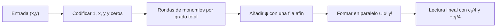

# Etapa 30 · Arquitectura cuadrática común del Lema 3.24

Base en la [PR #31](https://github.com/MichaelMobius/tesispucp/pull/31), commit `aeb8621ab5b9c8e398aaf7607b72961cfdd59a9d`. El enunciado se cotejó en la página impresa 113 del PDF normativo y la prueba en las páginas 112–116.

## Arquitectura y evaluación

`CapaCuadratica` contiene una matriz real de pesos y un vector de sesgos, indexados por tipos finitos. Evalúa $(Wz+b)^2$ coordenada a coordenada. `CapasCuadraticas` encadena estas matrices con índices de entrada y salida compatibles. Cada capa recibe únicamente la salida inmediata de la anterior. La lectura final es un producto escalar, con sesgo cero. `dimensiones` cuenta las coordenadas de salida de cada capa oculta y `profundidad` es la longitud de esa lista.

El banco representa cada valor $v$ por $E(v)=((v+1)^2,(v-1)^2)$. Una fila afín sobre los valores lógicos se traduce en una fila sobre los registros multiplicando por los coeficientes de decodificación $\pm1/4$. `capaTransporte_banco` verifica $E(v)\mapsto E(v)$. `capaPolarizar_eval` verifica el estado intermedio completo de un bloque, con registros transportados y pares $((u+v)^2,(u-v)^2)$. `bloqueRegistros_eval` demuestra que la segunda capa decodifica esos pares y vuelve a codificar el valor lógico obtenido. En particular, copia los registros pedidos y genera los productos pedidos con dos capas cuadráticas.

## Banco y tamaño

`enumeracion324` identifica $\mathrm{Fin}(D+1)\times\mathrm{Fin}(D+1)$ con los $N=(D+1)^2$ índices lineales. La construcción usa el mismo banco rectangular en todas las rondas. Inicializa $1,x,y$ en la primera capa y deja los demás registros codificados como cero. En la ronda de grado total $k+1$ solo se forman productos para los índices de ese grado. Si $i>0$, se usa $x\,x^{i-1}y^j$. Si $i=0$, se usa $y\,y^{j-1}$. El predecesor tiene grado total $k$, de modo que ya está disponible. `redMonomios_eval` prueba por inducción que el banco contiene exactamente $E(x^iy^j)$ para $i+j\le k$ y $E(0)$ en las otras posiciones.

Una capa adicional preserva el banco y codifica $\psi=1-x^2-y^2+x^2y^2$. Un bloque paralelo de dos capas forma los $N$ productos $\psi x^iy^j$. Esta programación por grados difiere de la programación secuencial de la prueba impresa, con el mismo tipo de operación neuronal en cada capa.

| Capas ocultas | Número de capas | Neuronas por capa |
|---|---:|---:|
| Inicialización y rondas de monomios | $1+2(2D-1)$ | $2N$ |
| Adición de $\psi$ | $1$ | $2(N+1)$ |
| Productos finales | $2$ | $2N$ |

`red324_dimensiones` verifica la lista real de anchos. El máximo es $2N+2$, que satisface $4N+4$. La profundidad es $4D+2$, que satisface $4N-4$ para los grados del enunciado. Para $m=1$, Lean verifica $D=3$, $N=16$, 14 capas ocultas y anchura a lo sumo 34, frente a las cotas de 60 capas y 68 neuronas de la tesis.

## Correspondencia con el enunciado

Para cada $m\ge1$, las matrices y sesgos de `red324` dependen solo de $D=4m-1$. Primero se fija la red y luego varían únicamente los $N$ parámetros $c_{ij}$. Cada parámetro establece un par de pesos de salida $c_{ij}/4,-c_{ij}/4$ mediante un mapa lineal continuo. `red324_salida` verifica en todo $\mathbb R^2$ la igualdad con $\psi\sum c_{ij}x^iy^j$. `clase324_eq_polinomios` traduce esa clase al grado parcial de `MvPolynomial`. `mapaCoeficientes324_inyectivo` usa la positividad de $\psi$ en el cuadrado abierto y la unicidad de polinomios en un producto de intervalos infinitos. `red324_dirichlet` recupera la condición homogénea en toda la frontera. El resultado establece realización exacta de esta clase finita de parámetros.

## Proposición 3.25

La construcción siguiente requiere interpolación univariada de Hermite con multiplicidad cuatro en los nodos distintos de cada proyección. Para muestras con coordenadas repetidas, se debe deduplicar por un patrón finito de igualdades y conservar los datos en todos los puntos originales. La cota uniforme exige estimar el resto y las derivadas hasta orden tres con constantes independientes de las separaciones entre nodos. Para la selección boreliana, se debe probar que cada estrato de igualdades es boreliano y que los coeficientes dependen continuamente de los nodos dentro del estrato. El producto tensorial y la fórmula de Leibniz con $\psi$ deben identificar el laplaciano en las muestras. La etapa 30 aporta la realización neuronal de esos polinomios una vez construidos.

## Verificación

Se conservan Lean `4.35.0`, Mathlib `v4.35.0` y EllipticPDE `c47acceaf985f59e1cf3257ffea077a73ea99dae`. Los módulos contienen las comprobaciones `#check` y `#print axioms`. El hash SHA-256 del PDF coincide con el inventario.
