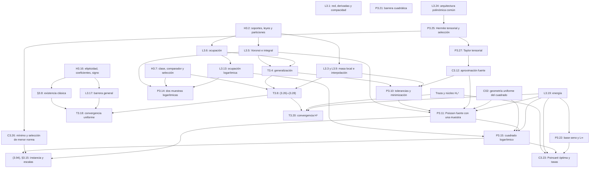

# Inventario formal del capítulo III

## Fuente y criterio

Fuente normativa de la etapa 17: `Tesis_PUCP/main.pdf` dentro de `Tesis_PUCP_Resumen_Conectores_20261108.zip`, SHA-256 `c6c612f7141c8c6ab5730fc0853b6d16222b97e5615e306f2e32191a49b686e0`. El capítulo ocupa las páginas impresas 30–135 (43–148 del PDF). El texto extraído de las 106 páginas coincide página por página con la revisión auditada de SHA-256 `139e14ba44af83e0a02e9bd767e8f213f6800e74afc24287fb12454bfa356d0f`. El archivo PDF suelto del mismo nombre que el ZIP tiene otro hash y queda fuera de la comparación. Los auxiliares LaTeX del ZIP se usan para ubicar etiquetas y comprobar fórmulas cuya extracción pierde superíndices o barras de clausura.

Base Lean `24bdd251953f0c526a7e84aaef9dc7a28ad3e1bb` de la PR #21, más los cambios explícitos de la etapa 20. Los nombres de Lean se citan en el espacio `TesisPINN` salvo indicación contraria. La dificultad mide la formalización restante, incluida la comparación de interfaces. Las prioridades A, B, C y D se refieren a dependencias imprescindibles, reutilización directa, infraestructura y clases concretas, respectivamente.

Estados: **E** equivalente en el alcance indicado de la fila, **R** demostrado con alcance o hipótesis más restrictivos, **P** parte demostrada, **F** interfaz declarada con obligaciones externas, **N** pendiente, **Bibl.** dependencia externa. En particular, **E** aplicado a una ecuación auxiliar no certifica su enunciado padre. Una hipótesis matemática se registra como premisa o interfaz, no como teorema pendiente de probar en general.

## Enunciados numerados

| ID | Resultado de la tesis | Página | Hipótesis | Dependencias | Declaración Lean | Estado | Dificultad | Prioridad |
|---|---|---:|---|---|---|---|---|---|
| L3.1 | Regularidad, cotas y precompacidad para la MLP de arquitectura fija | 33–42 | Activación $C^k$, parámetros en un compacto, $U$ acotado | Suavidad conjunta y compacidad | `lema31_regularidad`, `lema31_cotas_direccionales`, `lema31_precompacidad` | E en formulación de Fréchet y salida escalar. Falta la traducción multiíndice como declaración independiente. | Baja | C |
| H3.2 | Muestreo y geometría, con leyes, densidades positivas, particiones y cotas superiores de bolas cerradas | 43 | (U) acotado Lipschitz, $\Gamma\subseteq\partial U$ cerrado, leyes respecto a volumen y Hausdorff, i.i.d. internos e independencia mutua | Cap. I medidas, (3.4), ejemplo del cuadrado | `DatosMasa38`, `Muestreo38`, `DensidadInferior` | F, interfaz de masa 2/1 que omite hipótesis que su prueba no usa | Media | A |
| L3.3 | No degeneración de bolas abiertas, con constantes $c(2\sqrt d)^{-s}$ | 44 | H3.2, $d\ge2$, radio hasta $2\sqrt d\,\varepsilon_0$ | Celda de escala $r/(2\sqrt d)$ | `masa_bola_inferior_de_particiones`, `masa_bola_inferior_potencia` | R, $\sqrt 2$ y exponente de masa parametrizado | Baja | A |
| T3.4 | Generalización simultánea en evento medible de alta probabilidad | 48–51 | H3.2, radios admisibles, datos y operadores Hölder, pesos positivos | L3.5 y L3.6, (3.5)–(3.11) | `teorema34_dim2`, `teorema34_dim2_explicito` | R, caso escalar de masa 2/1. Quedan la formulación en dimensión general y (3.12) en dimensión uno. | Media | A |
| L3.5 | Cota integral determinista (3.13) a partir de cobertura | 51 | Bolas cerradas, leyes concentradas y residuos escalares integrables | Voronoi finito, Hölder e integración | `lema35_dim2`, `objetivoCoberturaIntegral_de_hipotesis` | R, interior de masa 2 y frontera de masa 1. | Media | A |
| L3.6 | Probabilidad de cobertura con masa mínima y parámetro de ocupación | 58–60 | Muestreo i.i.d., celdas finitas medibles, masa mínima, diámetro para cobertura | Probabilidad de celda vacía y cota de unión | `lema36_probabilidad_cobertura`, `lema36_fallo_parametro`, `lema36_shin`, `lema36_radio_shin_dim2` | E para las cotas abstractas de ocupación. R para el paquete geométrico con factor $\sqrt2$ y celdas disjuntas. | Baja | A |
| H3.7 | Clases neuronales $C^{k,\alpha}(\overline U)$, operadores Hölder, comparadores exactos con seminormas uniformes y selección mensurable | 64 | (f,g) Hölder, clase por par muestral, evento común conull para la sucesión | (3.22)–(3.25), para instancia manufacturada L3.24/P3.25 | `CotasHolder`, `ComparadorExacto`, premisas de `teorema38_dim2` | F, clase abstracta y cotas Hölder elegidas; instancia neuronal pendiente | Alta | D |
| T3.8 | Tasa de muestra finita en evento común y conclusiones casi seguras | 66–67 | H3.2 y H3.7, comparadores exactos y mínimos, pesos iguales, tamaños y regularidad | T3.4, L3.9, minimalidad y Borel–Cantelli | `teorema38_apartado1_dim2`, `teorema38_dim2` | R, escala escalar 2D. Persisten las premisas de las clases abstractas y el caso 1D. | Alta | A |
| L3.9 | Interpolación Hölder–$L^2$, $\|v\|_\infty\le C(Q+Q^{2\alpha/(2\alpha+s)})$ | 70 | Probabilidad métrica, masa abierta inferior $c\rho^s$ hasta $\rho_0$, (v) acotada y Hölder | Bola truncada, punto próximo al máximo, (3.35) | `abs_le_holder_add_de_integral`, `supResiduo_le_radio_truncado`, `tasa_supResiduo_de_integral` | P, cotas a radio fijado y transferencia de tasa; falta enunciado global literal | Baja | B |
| P3.10 | Comparador aproximado y suboptimalidad. Cotas de regularidad, objetivo y población. Bajo tolerancias $O(a_m)$, mismas tasas casi seguras que T3.8 | 75–77 | H3.2, parte 1 de H3.7, selección mensurable, pesos iguales, (3.36)–(3.38), comparabilidad y (3.42) para tasa | T3.4, T3.8, L3.9, álgebra de mínimos | `minimizadorAproximado_iff_le_infimo`, `cotas_minimizador_aproximado`, `perdidaPoblacional_aproximada_bajo_cobertura`, `proposicion310_dim2` | R, integración casi segura para residuos escalares y exponentes de masa 2 y 1 | Verificado en 2D | A |
| P3.11 | Poisson 2D fuerte con una muestra interior. Cota de cobertura, tolerancias y pérdida $O(m^{-\alpha/2})$, error $H^1=O(m^{-\alpha/4})$ | 77 | $U=(-1,1)^2$, ley uniforme, clase de traza exacta, crecimiento de prefijos, comparador y candidato subóptimo | Geometría del cuadrado, L3.5/L3.6, P3.10, L3.19, (3.44)–(3.55) | `proposicion311_perdida`, `proposicion311_poisson` | E para la pérdida con operador Hölder, R para la energía en $G+\psi q$ | Media | A |
| C3.12 | Aproximación fuerte $C^{k,\alpha}$ a escala $\sqrt{a_m}$ implica tolerancia empírica (O(a_m)) y regularidad uniforme | 80 | Operadores lineales continuos hacia los espacios Hölder, solución exacta, candidatos admisibles y criterio (3.56) | P3.10/P3.11, normas de operadores y pesos fijos | — | N | Media | B |
| L3.13 | Radios logarítmicos y cobertura eventual con fallo $n^{1-\kappa}/(\kappa\log n)$ | 82–83 | $\kappa>2$, $D,c,s>0$, particiones a escalas admisibles, prefijos i.i.d. y umbrales positivos | L3.6, $\exp(-\kappa\log n)=n^{-\kappa}$, series p, Borel–Cantelli | `lema313_cobertura_logaritmica` | E, geometría parametrizada por $D$ y extensión a tamaños $m(n)\ge n$ eventualmente | Verificado | A |
| P3.14 | Generalización logarítmica de dos muestras y tasa de pérdida $O((\log m_r/m_r)^{2\alpha/d}+(\log m_b/m_b)^{2\alpha/(d-1)})$ | 83–85 | H3.2, $d\ge2$, radios válidos, H3.7 y mínimos para el nuevo peso, crecimiento eventual | L3.5, L3.13, (3.59)–(3.63) | `proposicion314_dim2`, `limites_peso_log_dim2` | R, evento, cota y tasa demostrados en 2D escalar | Verificado en 2D | A |
| P3.15 | Poisson fuerte logarítmico con $\alpha=1/2$, $\kappa=3$, radio $\sqrt{54\log m/m}$ y pérdida $O((\log m/m)^{1/2})$ | 86 | Cuadrado uniforme, una muestra interior, umbrales de validez, comparador y tolerancia $O(a_m^{\log,\mathrm{int}})$ | P3.11, L3.13, (3.64)–(3.66) | `proposicion315_perdida`. `proposicion315_poisson` añade convergencia y tasa energética con levantamiento suave | F para la pérdida con operador Hölder; alcance energético limitado a $G+\psi q$ | Media | A |
| H3.16 | Elipticidad uniforme, simetría, coeficientes y derivadas con regularidad y cotas globales, esfera exterior y signo $\tilde c\le0$ | 91 | Operador en divergencia del Cap. I, $0<\alpha<1$ | Expansión a forma no divergente, existencia clásica | `OperadorEliptico.Datos`, `ContinuoEn`, `continuo_noDivergente`, `cotas_noDivergente` | F para la estabilidad, existencia clásica pendiente | Media | C |
| L3.17 | Estabilidad uniforme $\|v\|_\infty\le\|v\rvert_{\partial U}\|_\infty+C_0\|\mathcal L v\|_\infty$ | 92 | $U$ acotado, $v\in C^2(U)\cap C^0(\overline U)$, residuo acotado, coeficientes continuos, elipticidad y $\tilde c\le0$ | Barrera exponencial, máximo débil y (3.67)–(3.68) | `lema317_estabilidad_Linfty`, `cota318_error_dirichlet` | E, dimensión arbitraria positiva | — | A |
| T3.18 | Convergencia del aproximante en $C^0(\overline U)$ y tasa dominada por el residuo interior | 96 | H3.16, problema clásico y $\Gamma=\partial U$, candidatos clásicos, premisas de T3.8 | GT 6.13, T3.8, L3.17, orden de exponentes | `teorema318_dim2` | R, 2D con solución clásica dada | Media | A |
| L3.19 | Energía de Poisson con constante $C_P\sqrt{1+C_P^2}$ | 98 | Dominio acotado Lipschitz en $\mathbb R^d$, $e\in H_0^1$, $\Delta e\in L^2$, constante de Poincaré dada | Green distribucional, densidad, Poincaré, Cauchy–Schwarz | `energia_sobolev_plano_volumen`, `energia_cuadrado_uniforme` | R, puente distribucional en 2D, con elección de constante admisible | Media | A |
| T3.20 | Convergencia y tasa $H^1$ para Poisson con traza exacta, más ruta alternativa por supremo | 100 | Dominio Lipschitz, $Gamma=\partial U$, solución exacta distribucional $H^1\cap C^0(\overline U)$, candidatos de la misma traza y laplaciano $L^2$, T3.8 | Teorema de trazas (1.4), L3.19, T3.8, densidad residual inferior | `teorema320_poisson_de_teorema38`, `teorema320_levantado_de_teorema38` | R, cuadrado con $\psi q$ o $G+\psi q$ suaves y premisa afín $H_0^1$ | Alta | C |
| P3.21 | Barrera cuadrática para Poisson, constante $1/2$ del residuo supremo | 104 | Cuadrado, $v\in C^2(U)\cap C^0(\overline U)$ | Barrera $b=(2-x^2-y^2)/4$, máximo débil | `proposicion321_barrera_cuadratica`, `proposicion321_Linfty_extendido` | E, supremo real con residuo acotado y norma esencial extendida | — | B |
| P3.22 | Representante continuo y control $L^2\to L^\infty$ por constante espectral $\le0.26404$ | 105 | Cuadrado, $e\in H_0^1$, $\Delta e\in L^2$ | Base seno tensorial, Parseval, Green, convergencia absoluta y uniforme, suma certificada | `proposicion322_espectral_completa` | E | Verificado | C |
| C3.23 | Poincaré óptima $\sqrt2/\pi$, constantes simultáneas y tasa logarítmica $H^1+L^\infty$ | 109 | Misma traza, residuo $L^2$ y, para tasa, P3.15 | P3.22, P3.15, L3.19, primera autofunción y núcleo de la traza | `cotas_simultaneas323_traza`, `corolario323_traza`, `nucleo_trazaSobolevCuadrado_eq_H01` | E para (3.80)–(3.82) en el cuadrado. (3.83) verificada en la instancia escalar de P3.15. | Baja | C |
| L3.24 | Arquitectura cuadrática común para toda clase polinómica, capas ocultas fijas y salida lineal variable | 113 | $m\ge1$, $D=4m-1$, $N=(D+1)^2$, factor $\psi$ | Registros codificados, producto, generación de monomios y transporte sin saltos | `lema324`, `clase324_eq_polinomios`, `red324_cotas` | E, realización exacta con las cotas originales | — | D |
| P3.25 | Comparadores exactos de Hermite, cotas uniformes, selección boreliana y realizaciones cuadráticas | 116–122 | Solución manufacturada, $m\ge1$, proyecciones deduplicadas | L3.24, (3.88)–(3.90), Cauchy, matriz confluente y Horner | `proposicion325_arquitectura_comun`, `factorHermite325_resto_c3_base_dos_tercios`, `comparador325_horner` | E para la arquitectura común y la realización particular. | — | D |
| C3.26 | Existencia de mínimos, selección boreliana y cotas de (3.91) en la clase polinómica | 122–125 | Clase (3.87), muestra interior positiva, $\alpha=1/2$ y peso positivo | L3.24, P3.25, unicidad de Dirichlet, compacidad y Lusin–Souslin | `corolario326`, `funcional326_eq_infimo` | E para el funcional interior normativo y la red común. | — | D |
| P3.27 | Comparador de Taylor, resto $C^3$, elección de grado y tolerancias | 127–130 | Solución manufacturada, $N_m=\lceil2\log_2 m\rceil$, $\alpha=1/2$ | Serie compleja, Cauchy, Leibniz, L3.24 y C3.12 | `resto_taylorManufacturada_c3`, `proposicion327`, `comparadorTaylor327_tolerancia_empirica` | E en la instancia manufacturada para ambos pesos. | — | D |

## Ecuaciones numeradas

La matriz usa `3.x` precedido de **Ecu.** para distinguirlo del enunciado que tiene la misma numeración. Las ecuaciones (3.44)–(3.45) se leen en la p. 78 del PDF y carecen de etiqueta individual en el auxiliar LaTeX.

| ID | Resultado de la tesis | Página | Hipótesis | Dependencias | Declaración Lean | Estado | Dificultad | Prioridad |
|---|---|---:|---|---|---|---|---|---|
| Ecu. 3.1 | Problema abstracto L[u]=f en U y B[u]=g en Γ | 32 | Definición operativa de L y B | Cap. I/II | Operadores38 | F, operadores abstractos | Media | A |
| Ecu. 3.2 | Cota inductiva Mℓ,s sobre derivadas de cada capa | 34 | Parámetros acotados, activación suave | L3.1, cadena | — | N | Baja | B |
| Ecu. 3.3 | Cota de derivadas de la preactivación afín | 36 | Cota de pesos y capa anterior | L3.1, (3.2) | — | N | Baja | B |
| Ecu. 3.4 | Cotas de masa de bolas cerradas de ambos soportes | 43 | Radios hasta ε₀, exponentes d y d−1 | H3.2 | MasaBolaSuperior | E, como premisa paramétrica | Verificado | A |
| Ecu. 3.5 | Radios originales εr, εb de escala raíz | 48 | Tamaños positivos y masas mínimas | L3.6 | `radio34_eq`, `radio34_potencia_interior`, `radio34_potencia_frontera` | R, 2D | — | A |
| Ecu. 3.6 | Factor de cobertura $C_m$ | 48 | Radios (3.5) | L3.5 | `factorCoberturaCuadrado_radio34` | R, 2D | — | A |
| Ecu. 3.7 | Pesos mínimos de regularización 3λε^(2α)/C_m | 49 | C_m positivo | (3.5), (3.6) | pesoCobertura | E, fórmula | Verificado | A |
| Ecu. 3.8 | Funcional empírico con pesos mínimos | 49 | Pérdida y regularizadores de operador | H3.2, (3.7) | ProblemaPINN.funcionalRegularizado | E, escalar con elección exacta | Verificado | A |
| Ecu. 3.9 | Constante $C'$ de las contribuciones Hölder de los datos | 49 | Datos Hölder y masas positivas | (3.5), (3.13) | `constante34`, `datos34_le` | R, 2D, seminormas exactas o mayorantes | — | A |
| Ecu. 3.10 | Probabilidad conjunta de cobertura con fallos binomiales | 49 | Particiones y muestreos i.i.d. | L3.6 y unión | `evento_cobertura34_dim2`, `probabilidad34_pos` | R, 2D con evento medible | — | A |
| Ecu. 3.11 | Cota poblacional en evento común para todos los candidatos | 49 | Pesos y radios de T3.4 | (3.5)–(3.10), L3.5 | `teorema34_dim2_explicito` | R, 2D con sumas e integrales explícitas | — | A |
| Ecu. 3.12 | Versión 1D con frontera determinista y solo regularización interior | 50 | Extremos disponibles, muestras interiores | L3.5/L3.6 en 1D | — | N | Media | A |
| Ecu. 3.13 | Cota integral de cobertura con errores de datos separados | 51 | Cobertura, masas e integrabilidad | L3.5, (3.14)–(3.17) | objetivoCoberturaIntegral_de_hipotesis | R, 2D escalar | Media | A |
| Ecu. 3.14 | Cuadrado de suma de tres términos acotado por tres veces suma de cuadrados | 53 | Escalares en Lean | Cauchy–Schwarz | cuadrado_suma_tres_le | E, escalares | Verificado | B |
| Ecu. 3.15 | Defecto puntual interior estimado desde vecino más próximo | 54 | Hölder de L y f | L3.5, (3.14) | residuo_puntual_en_celda | E, escalar | Verificado | B |
| Ecu. 3.16 | Defecto puntual de frontera estimado desde vecino | 55 | Hölder de B y g | L3.5, (3.14) | residuo_puntual_en_celda | E, escalar | Verificado | B |
| Ecu. 3.17 | Masa de celda de Voronoi interior ≤ C_r ε_r^d | 57 | Cobertura, centro en soporte | (3.4), Voronoi | medida_celdaVoronoi_le | E, exponente genérico | Verificado | A |
| Ecu. 3.18 | Ocupación con fallo ≤ K(1−p)^m y mayorante exponencial | 59 | Celdas medibles, masa mínima e i.i.d. | Probabilidad de celda vacía y unión | `lema36_probabilidad_cobertura` | E para ocupación abstracta | — | A |
| Ecu. 3.19 | Fallo ≤ (m/t)exp(−t) | 59 | t>0, m>0 y masa mínima t/m | L3.6, (3.18) | `escalaAuxiliarParametro_masa`, `lema36_fallo_parametro` | E para ocupación abstracta | — | A |
| Ecu. 3.20 | Número de celdas ≤ 1/$cε^s$ | 60 | Solapamientos de masa nula y masa mínima positiva | H3.2, aditividad | `cardinal_por_masa_minima_ae` | E para el cardinal | — | A |
| Ecu. 3.21 | Condición de comparación de pesos admisibles con los mínimos | 63 | Pesos mínimos positivos | (3.7), selección de pesos | pesoInterior_le_igual; pesoFrontera_le_igual | P, elección igual | Media | A |
| Ecu. 3.22 | Funcional regularizado con dos seminormas cuadradas | 63 | Clase y operadores Hölder | H3.7, pérdida empírica | ProblemaPINN.funcionalRegularizado | E, escalar con seminormas exactas | Verificado | A |
| Ecu. 3.23 | Ambos pesos iguales al máximo de los pesos mínimos | 63 | C_m positivo | (3.7), (3.21) | pesoRegularizacionIgual | E, fórmula | Verificado | A |
| Ecu. 3.24 | Pérdida empírica nula del comparador | 64 | Admisibilidad, datos de entrenamiento | H3.7 | ProblemaPINN.ComparadorExacto | E, premisa | Verificado | A |
| Ecu. 3.25 | Seminormas Hölder uniformemente acotadas de comparadores | 64 | Clase y evento común, selección | H3.7 | Premisa de teorema38_dim2 | F, cotas elegidas | Media | A |
| Ecu. 3.26 | Tasa poblacional $O(m_r^{-\alpha/d})$ | 66 | Cobertura, comparador exacto, pesos iguales y relación de tamaños | T3.4 y minimalidad | `teorema38_apartado1_dim2`, `teorema38_dim2` | R, muestra finita y tasa eventual casi segura en dimensión dos | — | A |
| Ecu. 3.27 | Convergencia uniforme en clausura interior y en Γ | 66 | Hipótesis de T3.8 | L3.9, (3.26) | teorema38_dim2 | R, supremo sobre soporte, 2D | Media | A |
| Ecu. 3.28 | Tasas uniformes con exponentes −α²/[d(2α+d)] y −α²/[d(2α+d−1)] | 67 | Hipótesis de T3.8 | L3.9, (3.26) | teorema38_dim2 | R, 2D | Media | A |
| Ecu. 3.29 | Cota de regularidad del minimizador por la del comparador | 68 | Mínimo exacto, comparador exacto, a_m positivo | Minimalidad, (3.22)–(3.25) | ProblemaPINN.regularidad_minimizador_le_comparador | E, núcleo escalar | Verificado | A |
| Ecu. 3.30 | Pérdida empírica del minimizador ≤ a_m R* | 68 | Mismas premisas que (3.29) | Minimalidad | ProblemaPINN.perdidaEmpirica_le_regularidad_uniforme | E, núcleo escalar | Verificado | A |
| Ecu. 3.31 | Orden de C_m a_m en la tasa poblacional | 68 | Radios, pesos y comparabilidad de tamaños | (3.5)–(3.7), (3.23) | factor_mul_peso_igual; tasa_de_cota_cobertura | R, 2D | Media | A |
| Ecu. 3.32 | Normas L² de residuos en las leyes de muestreo tienden a cero | 70 | Pesos positivos y (3.26) | Pérdida poblacional | convergencia_y_tasas_uniformes_ae | P, argumento de integrales en la cadena, sin enunciado separado | Media | A |
| Ecu. 3.33 | Regularidad Hölder uniforme de ambos residuos | 70 | Regularidad de minimizadores y datos | (3.29), desigualdad triangular | holder_residuos_minimizador | E, núcleo escalar | Verificado | A |
| Ecu. 3.34 | Interpolación Hölder–L² en toda escala admisible | 71 | Masa local y v acotada Hölder | L3.9, (3.35) | supResiduo_le_radio_truncado | P | Baja | B |
| Ecu. 3.35 | Cota inferior de integral en bola de radio truncado según el supremo | 71 | Masa local y Hölder | L3.9 | abs_le_holder_add_de_integral | P, desigualdad relacionada | Baja | B |
| Ecu. 3.36 | Tolerancia empírica ε_m del comparador | 75 | Comparador admisible | P3.10 | Premisa de cotas_minimizador_aproximado | F | Media | A |
| Ecu. 3.37 | Regularidad del comparador ≤ R* | 75 | Comparador admisible | P3.10 | Premisa de cotas_minimizador_aproximado | F | Media | A |
| Ecu. 3.38 | Suboptimalidad δ_m respecto al ínfimo | 75 | Clase no vacía y objetivo acotado por abajo | P3.10 | ProblemaPINN.minimizadorAproximado_iff_le_infimo | E, equivalencia de representaciones | Verificado | B |
| Ecu. 3.39 | Regularidad del aproximado ≤ R*+(ε_m+δ_m)/a_m | 75 | a_m positivo, (3.36)–(3.38) | Minimalidad aproximada | ProblemaPINN.cotas_minimizador_aproximado | E, núcleo escalar | Verificado | B |
| Ecu. 3.40 | Objetivo regularizado ≤ a_m[R*+(ε_m+δ_m)/a_m] | 75 | Mismas premisas que (3.39) | Minimalidad aproximada | ProblemaPINN.cotas_minimizador_aproximado | E, núcleo escalar | Verificado | B |
| Ecu. 3.41 | Pérdida poblacional acotada con tolerancias | 75 | Cobertura, (3.36)–(3.38), pesos iguales | (3.13), (3.40) | perdidaPoblacional_aproximada_bajo_cobertura | R, 2D con términos de datos en radios | Media | A |
| Ecu. 3.42 | Criterio de tolerancias ε_m+δ_m≤K a_m eventual | 76 | Cota K determinista y peso original de (3.23) | P3.10 | Premisa eventual de `proposicion310_dim2` | E en la instancia 2D | Verificado | A |
| Ecu. 3.43 | Tasa poblacional casi segura bajo tolerancias, seguida de (3.27)–(3.28) | 76–77 | Hipótesis de P3.10 y (3.42) | Borel–Cantelli, (3.31), (3.41), L3.9 | `proposicion310_dim2` | R, demostrado en 2D escalar | Verificado en 2D | A |
| Ecu. 3.44 | Pérdidas interior empírica y poblacional E_m, E | 78 | Poisson, muestra interior, ley uniforme | P3.11 | `perdidaEmpiricaInterior`, `perdidaPoissonInterior_eq` | E | Media | A |
| Ecu. 3.45 | Regularizador de Δh y objetivo J_m de una muestra | 78 | Seminorma Hölder exacta, peso interior | P3.11 | `seminormaInterior`, `funcional311` | E | Media | A |
| Ecu. 3.46 | Radio interior original 3√2 m^(−1/4) | 78 | Cuadrado, c_r=1/9, radio admisible | Geometría, (3.5) | `radioRaizCuadrado_eq`, `radioRaizCuadrado_le_uno_iff` | E | Media | A |
| Ecu. 3.47 | Factor interior 27π√m/2 | 78 | c_r=1/9, C_r=π/4 | (3.46), L3.5 | `factorRaizInterior_eq` | E | Media | A |
| Ecu. 3.48 | Peso interior original con α general | 78 | C_m interior positivo | (3.46), (3.47) | `pesoRaizInterior`, `pesoRaizInterior_eq_potencia` | E | Media | A |
| Ecu. 3.49 | Probabilidad de cobertura interior | 78 | Muestras i.i.d., radios admisibles | L3.6, (3.46) | `ocupacion311`, `evento311` | E, mayorante binomial | Media | A |
| Ecu. 3.50 | Cota de E en función de J_m y datos | 78 | Evento de cobertura interior | L3.5, (3.44)–(3.48) | `perdida311_bajo_cobertura` | E | Media | A |
| Ecu. 3.51 | Tolerancias η_m y δ_m, y regularidad R* | 78 | Clase de Dirichlet exacto | P3.11 | `Selecciones311` | F, hipótesis variacionales y selecciones | Media | A |
| Ecu. 3.52 | Control de regularidad del minimizador interior | 79 | a_m interior positivo | (3.51), (3.39) | `cotas311` | E | Media | A |
| Ecu. 3.53 | Cota de pérdida poblacional interior aproximada | 79 | Cobertura y (3.51) | (3.50), (3.52) | `cotas311` | E | Media | A |
| Ecu. 3.54 | Peso explícito 2√2 m^(−3/4)/(3π) y pérdida O(m^(−1/4)) | 79 | α=1/2 | (3.46)–(3.48) | `pesoRaizInterior_medio`, `proposicion311_perdida` | E | Media | A |
| Ecu. 3.55 | Error energético O(m^(−1/8)) a.s. de una muestra para α=1/2 | 79 | Cota de tolerancias y Dirichlet exacto | P3.11, L3.19 | `proposicion311_poisson` | R, demostrado para $G+\psi q$ y todo $0<\alpha\le1$ con exponente $\alpha/4$ | Media | A |
| Ecu. 3.56 | Criterio de aproximación fuerte ≤ A√a_m | 80 | Regularidad y admisibilidad de comparadores | C3.12, P3.27 | `comparadorTaylor327_criterio_fuerte` | R, instancia manufacturada para raíz y logarítmico. Caso general pendiente. | Baja | B |
| Ecu. 3.57 | Escala auxiliar y radio logarítmicos | 82 | κ>2, n≥3, validez geométrica | L3.13, L3.6 | `escalaAuxiliarLog`, `radioCoberturaLog`, `radioLog_eventualmente_admisible` | E | Verificado | B |
| Ecu. 3.58 | Fallo n^(1−κ)/(κ log n) | 82 | Muestras i.i.d. y particiones | (3.57), L3.6 | `falloOcupacion_le_escala_log`, `lema313_cobertura_logaritmica` | E, complemento medible de la ocupación | Verificado | B |
| Ecu. 3.59 | Radios logarítmicos interior y frontera | 84 | d≥2, validez de particiones | L3.13 | `radioCoberturaLog`, `radioLog_tendsto_cero` | E, con factor y dimensión de masa parametrizados | Verificado | A |
| Ecu. 3.60 | Constantes y pesos iguales logarítmicos | 84 | Radios positivos | (3.59), (3.23) | `Operadores38.baseLog`, `factor_cobertura_log_dim2`, `factor_mul_peso_igual` | R, 2D | Verificado en 2D | A |
| Ecu. 3.61 | Probabilidad conjunta de cobertura logarítmica | 84 | Hipótesis geométricas y de muestreo de P3.14 | L3.13, unión | `proposicion314_dim2` | R, evento medible en 2D | Verificado en 2D | A |
| Ecu. 3.62 | Cota poblacional logarítmica simultánea | 84 | Cobertura y regularizadores de operador | L3.5, (3.60) | `proposicion314_dim2` | R, para todo candidato admisible escalar en 2D | Verificado en 2D | A |
| Ecu. 3.63 | Tasa poblacional logarítmica de dos muestras | 84 | Comparadores y mínimos para nuevo peso | P3.14, Borel–Cantelli | `proposicion314_dim2` | R, suma de las dos tasas en 2D escalar | Verificado en 2D | A |
| Ecu. 3.64 | Radio, factor y peso logarítmicos explícitos del cuadrado | 86 | κ=3, α=1/2, m≥310 | L3.13, geometría | `radioLogCuadrado_admisible`, `factorLogInterior_eq`, `pesoLogInterior_eq` | F | Media | A |
| Ecu. 3.65 | Cota logarítmica explícita de pérdida interior | 87 | Evento medible de ocupación y soporte | P3.15, (3.64) | `proposicion315_perdida` | F | Media | A |
| Ecu. 3.66 | Tasa logarítmica de pérdida $O((\log m/m)^{1/2})$ | 87 | Comparadores, candidatos subóptimos y tolerancias | (3.65), L3.13 | `proposicion315_perdida` | F | Media | A |
| Ecu. 3.67 | Cota suprema para operador elíptico general | 92 | Elipticidad, signo, cotas, residuo acotado | L3.17, máximo débil | `lema317_estabilidad_Linfty` | E | — | C |
| Ecu. 3.68 | Cota suprema del error por defectos interior y frontera | 93 | Solución y candidato clásicos | L3.17, (3.67) | `cota318_error_dirichlet_Linfty` | E | — | C |
| Ecu. 3.69 | Convergencia uniforme de aproximantes | 96 | Hipótesis de T3.18 | L3.17, (3.27) | `teorema318_dim2` | R, 2D con solución dada | Media | C |
| Ecu. 3.70 | Tasa uniforme del error dominada por el interior | 96 | Hipótesis de T3.18 | L3.17, (3.28) | `teorema318_dim2`, `exponente318_orden` | R, 2D con solución dada | Media | C |
| Ecu. 3.71 | Cota energética por Poincaré y laplaciano distribucional | 98 | e∈H₀¹, Δe∈L² | L3.19 | energia_sobolev_plano_volumen; energia_cuadrado_uniforme | R, 2D | Media | A |
| Ecu. 3.72 | Convergencia H¹ a.s. | 101 | Hipótesis de T3.20 | L3.19, T3.8 | Dos puentes integrados de 3.20 | R, cuadrado y candidatos suaves | Media | A |
| Ecu. 3.73 | Tasa H¹ O$mr^(−α/(2d))$ | 101 | Hipótesis de (3.72) y densidad inferior | (3.26), (3.74) | Dos puentes integrados de 3.20 | R, cuadrado y candidatos suaves | Media | A |
| Ecu. 3.74 | Cota H¹ por ‖f−Δh‖₂ | 101 | Misma traza y laplacianos L² | L3.19, núcleo de traza | estimacion_uniforme_psi_solucion_exacta; energia_de_perdidaLevantada | R | Media | A |
| Ecu. 3.75 | Tasa H¹ alternativa vía norma suprema | 102 | Hipótesis de T3.20 | Volumen finito, (3.28), (3.74) | — | N como composición | Media | A |
| Ecu. 3.76 | Constante 1/2 de la barrera cuadrática | 104 | Cuadrado, v clásica y continua hasta frontera | P3.21, máximo débil | `proposicion321_Linfty_extendido` | E, con ley de frontera de soporte completo | — | C |
| Ecu. 3.77 | Constante espectral de L² a L∞ y cota decimal | 105 | Cuadrado, $H_0^1$, residuo L² | P3.22, completitud y (3.79) | `proposicion322_espectral_completa` | E | Verificado | C |
| Ecu. 3.78 | Parseval para coeficientes del residuo en base seno | 106 | L² sobre el cuadrado | Completitud de base | `modoSenoLp_parseval` | E | Verificado | C |
| Ecu. 3.79 | Identidad débil que relaciona coeficientes por λ_jk | 106 | e∈H₀¹, Δe∈L², autofunción seno | Green bilineal y ecuación del modo | `coeficiente_laplaciano_modoSeno` | E | Verificado | C |
| Ecu. 3.80 | Constante de Poincaré óptima √2/π | 109 | Cuadrado, $H_0^1$ | Bessel para gradientes, Parseval y primer modo | `poincare_cuadrado_espectral`, `poincare_cuadrado_constante_minima` | E | Verificado | C |
| Ecu. 3.81 | Constante explícita de energía con Poincaré óptima | 109 | Misma traza, Δe∈L² | (3.71), (3.80), núcleo de la traza | `cotas_simultaneas323`, `cotas_simultaneas323_frontera_puntual` | R, para diferencia en $H_0^1$ o igualdad puntual de representantes continuos | Media | C |
| Ecu. 3.82 | Control L∞ por 0.26404 veces el residuo | 109 | Mismas premisas de (3.81) | P3.22 y núcleo de la traza | `cotas_simultaneas323`, `cotas_simultaneas323_frontera_puntual` | R, mismo alcance que (3.81) | Media | C |
| Ecu. 3.83 | Tasa simultánea H¹+L∞ O$(log m/m)^(1/4)$ | 109 | Hipótesis de P3.15 | (3.66), (3.81)–(3.82) | `corolario323_escalar`, `corolario323_frontera_puntual`, `corolario323_poisson_levantado` | R, casi segura para los mismos prefijos con error de Dirichlet verificado | Media | A |
| Ecu. 3.84 | Solución seno manufacturada y fuente −2π²u* | 111 | Cuadrado, dato homogéneo | Derivación clásica, signos | `laplaciano_solucionManufacturada`, `solucionManufacturada_factorizada` | E | — | D |
| Ecu. 3.85 | Cociente a(t), valores removibles y extensión entera | 111 | Ceros simples ±1 | Orden analítico y derivación en la raíz | `aManufacturadaCompleja_entera`, `aManufacturada_extension` | E | — | D |
| Ecu. 3.86 | Multiplicación exacta con dos neuronas cuadráticas | 112 | Entradas reales y salida lineal | Identidad de cuadrados | multiplicacion_cuadratica | E para identidad, P para representación MLP | Verificado | D |
| Ecu. 3.87 | Clase determinista ψp de grados parciales ≤4m−1 | 116 | m≥1 | L3.24, P3.25 | `clase324_eq_polinomios`, `lema324` | E, representación de la clase | — | D |
| Ecu. 3.88 | Interpolación exacta del residuo y de la frontera y cota $C^3$ uniforme | 116 | Cualquier muestra ordenada en la clausura | P3.25, L3.24, Hermite, Cauchy y Leibniz | `proposicion325_arquitectura_comun` | E para interpolación y regularidad en la arquitectura común. | — | D |
| Ecu. 3.89 | Resto de Hermite por integral de contorno | 120 | Nodos distintos en el intervalo, multiplicidad cuatro, $a$ entera | Cauchy, divisibilidad y cancelación en un anillo | `restoContornoHermite_formula`, `factorHermite325_formula` | E, numerador $a$ y signo $a-p$. | — | D |
| Ecu. 3.90 | Resto $C^3$ de Hermite con mayorante $(1+N)^3(2/3)^N$ | 121 | Nodos en $[-1,1]$, $N=4r$ por proyección | (3.89), cota del cociente nodal y Cauchy en radio $1/(N+2)$ | `factorHermite325_resto_c3_base_dos_tercios` | E, constante independiente de los nodos. | — | D |
| Ecu. 3.91 | Cotas de regularidad y pérdida de cualquier minimizador | 123 | Muestra interior y peso positivo, comparador de Hermite exacto | C3.26 y P3.25 | `cotas_minimizador326` | E, constante independiente de muestra, tamaño y peso. | — | D |
| Ecu. 3.92 | Resto $C^3$ de Taylor ≤ $C(1+N)^3 2^{-N}$ | 127–128 | Función entera, todo $N$ natural | Cauchy en radio dos, cola y radio local $1/(N+2)$ | `resto_taylorManufacturada_c3` | E para las cuatro derivadas. | — | D |
| Ecu. 3.93 | Resto $C^3$ tensorial ≤ $C'(1+\log m)^3 m^{-2}$ | 129 | $N_m=\lceil2\log_2 m\rceil$, estimación válida para $m\ge1$ | (3.92), Leibniz y cota del techo | `comparadorTaylor327_error_c3` | E, derivadas mixtas en la clausura. | — | D |
| Ecu. 3.94 | Tasas de la clase manufacturada, peso raíz y régimen logarítmico del párrafo posterior | 130 | Mínimos globales seleccionados, Dirichlet exacto y ley uniforme interior | P3.11/P3.15, P3.25, C3.26, C3.23 | `convergencia_neuronal_manufacturada` | E para el régimen logarítmico, tasa simultánea $H^1+L^\infty$. Instanciación con peso raíz pendiente. | Media | D |

## Definiciones, observaciones y construcciones sin número propio

Los siguientes bloques agrupan definiciones y pasos contiguos de una misma demostración. Se excluyen ejemplos experimentales sin afirmación matemática y referencias históricas que no se usan como premisas. Las identidades numéricas de §3.15 se incluyen por su papel en la interpretación de las cotas.

| ID | Resultado de la tesis | Página | Hipótesis | Dependencias | Declaración Lean | Estado | Dificultad | Prioridad |
|---|---|---:|---|---|---|---|---|---|
| D01 | Residuos interior y de frontera, medidas empíricas, pérdidas ponderadas y funcional regularizado | 30–33 | Operadores, datos y pesos positivos | Cap. I, §2.3, Ecu. 3.1, 3.8, 3.22 | `ProblemaPINN`, `Operadores38` | E para el escalar parametrizado, F para una clase de redes | Baja | A |
| C01 | Diferenciar la MLP por capas. Entrada identidad, derivada afín, fórmula por particiones de Faà di Bruno y telescopado de productos | 33–42 | Activación suficientemente suave, arquitectura fija, parámetros y entradas acotados | L3.1, Ecu. 3.2–3.3 | — | N | Alta | C |
| O01 | Equicontinuidad en la clausura a partir de cotas de derivadas en una caja y compacidad de la imagen en C^k; la sola densidad en C⁰ es insuficiente | 33, 38–42, 65 | Segmentos en caja convexa para el primer paso; bola compacta de parámetros para el segundo | L3.1, MVT, continuidad parámetro–función | — | N | Alta | C |
| C02 | Cuadrícula semiabierta de lado 2/⌈2/ε⌉, medida uniforme de área 1/4 y longitud 1/8, constantes c_r=1/9, C_r=π/4, c_b=1/12, C_b=1, ε₀=1 | 45–47 | Cuadrado abierto, frontera completa, vértices sin masa | H3.2, longitud de intersección con los cuatro lados, área de disco | `particiones_uniformes_cuadrado`, `masa_bola_uniforme_cuadrado` | P, geometría interior demostrada; pendiente la ley de frontera | Media | A |
| O02 | Masa local inferior como consecuencia de las particiones; distinción entre muestreo geométrico y existencia de comparadores | 44–47 | H3.2, masa mínima | L3.3, H3.7 | `masa_bola_inferior_de_particiones` | R, caso de diámetro √2 | Baja | A |
| C03 | Celdas de Voronoi medibles con desempate por índice mínimo, sumas de masas y valores de residuo | 52–58 | Lista finita no vacía, distancias continuas; se permiten repeticiones | L3.5, particiones y cotas cerradas | `celdaVoronoi_cover`, `celdaVoronoi_pairwise`, `celdaVoronoi_measurable`, `suma_masas_celdas` | E para la partición | Verificado | A |
| C04 | Celdas vacías, cota de unión, ocupación implica cobertura; eventos para prefijos y fallos sumables | 58–62, 68–70 | i.i.d., masa mínima, diámetros y crecimiento | L3.6, Borel–Cantelli | `medida_celdaVacia`, `ocupacion_eventual_casi_segura`, `cobertura_eventual_de_particiones_raiz` | E para piezas y escala raíz | Baja | A |
| C05 | Frontera en 1D como conjunto de extremos disponibles y término empírico exacto de frontera | 44, 50–51, 61–62, 72–73 | Intervalo y observación determinista en los extremos | T3.4, T3.8, dos pesos positivos | — | N | Media | A |
| O03 | Regularizar el operador o su residuo puede cambiar el mínimo. La condición de pesos (3.21) no controla su cociente; para d=2, mr=mb, el cociente mínimo crece como n^(α/2) | 48–51, 63, 73–74 | Datos Hölder, escalas originales | Ecu. 3.5–3.9, 3.21–3.23 | `pesoRegularizacionIgual`, `factor_mul_peso_igual` | P, falta contraejemplo de cociente | Baja | B |
| O04 | Comparadores simultáneos en un evento común, cotas deterministas o dependientes de la realización, caso trivial si u* pertenece a toda clase | 64–65 | Interpolación, selección mensurable y control Hölder | H3.7, T3.8 | `teorema38_dim2` recibe la formulación conull | F | Media | A |
| O05 | Integrabilidad, continuidad uniforme hasta la clausura, norma suprema frente al control de pérdida y exponente de frontera distinto del interior | 70–74 | Leyes concentradas, dominios acotados y Hölder, pesos positivos | T3.8, L3.9, densidad de U en su clausura | `poblacionIntegrable_de_holder_acotado`, `supResiduo`, `measurable_supResiduo_de_denso` | P, falta empaquetar extensión en C⁰(Ū) | Media | A |
| O06 | Pérdida empírica y regularizador discreto de pares no certifican tolerancia del funcional continuo. La tasa no es respecto del número de iteraciones del optimizador | 73–76, 89, 102–103, 130–135 | Definición de objetivo y supuestos de suboptimalidad | P3.10, P3.15, §3.15 | `EsMinimizadorAproximado` expresa la premisa correcta | F, sin certificación experimental | — | D |
| C06 | Criterio fuerte de comparadores en la especialización interior. Derivadas hasta orden k y continuidad de operadores implican pérdidas cuadráticas pequeñas uniformemente en nodos | 80–81 | Normas de operador, dato exacto y cota O(√a_m) | C3.12, P3.10/P3.11 | — | N | Media | B |
| C07 | Validez de radio logarítmico para m≥310, serie de fallos, mejora del exponente con nuevo peso y relación de escalas de tolerancia | 82–90 | κ=3 en el cuadrado y α=1/2 para constantes, κ>2 en general | L3.13–P3.15, logaritmos y p-series | `radioLogCuadrado_admisible`, `ocupacion315`, `proposicion315_perdida` | F para los umbrales y tasas interiores de P3.15 | Media | A |
| E01 | Existencia y unicidad clásica interior C^{2,α}_loc y continua hasta frontera por esfera exterior, sin regularidad global C^{2,α} | 90–92 | H3.16, g continuo, α∈(0,1), signo de orden cero | Gilbarg–Trudinger 6.13 | EllipticPDE aporta máximo y unicidad clásicos | Bibl., existencia clásica general pendiente | Alta | C |
| C08 | Expansión a forma no divergente y cotas de deriva. Barrera exponencial con λ₀ y cota de la deriva; máximo débil sobre ambos signos | 91–96 | H3.16 para coeficientes; L3.17 usa elipticidad, signo y cotas | Regla del producto, compacidad y principio máximo débil | `aplica_eq_noDivergente`, `barrera317`, `maximo_debil` | E | — | A |
| O07 | Esfera exterior para existencia, estimación de estabilidad independiente de ella. Corrección de signo y comparación de exponentes de estabilidad uniforme y energética | 95–98, 102–104 | Solución dada para estabilidad, L=Δ para energía, L=−Δ cambia simultáneamente el dato | L3.17–T3.20 | Signos en `laplaciano_error_psi_solucion_exacta`; resto pendiente | P | Media | A |
| C09 | Green por densidad, caso gradiente cero, normalización de norma H¹, igualdad de trazas y comparación ponderada con densidad inferior | 98–103 | $H_0^1$, residuo L², densidad inferior; dominio Lipschitz para traza | L3.19, T3.20, teorema (1.4) | `green_por_densidad`, `norma_sobolev_cuadratica`, `cota_norma_sin_superior` | P, falta traza y dimensión general | Alta | A |
| C10 | Base seno tensorial, autofrecuencias π²(j²+k²)/4, serie uniforme, agrupación por max(j,k) y cola ≤N⁻² | 105–110 | Cuadrado, residuo L² y $H_0^1$ | Stone–Weierstrass, Green, Bessel, Cauchy–Schwarz, prueba M | `baseHilbertSenoCuadrado`, `modoSeno_ecuacion`, `serieSeno_representa_error`, `sumaEspectral_cola` | E | Verificado | C |
| C11 | Factorización u*=ψa(x)a(y), nodos coordenados distintos, multiplicidad 4, evaluación de jets e inyectividad por divisibilidad | 111, 116–119 | m≥1 y coordenadas repetidas permitidas | Ecu. 3.84–3.88, rango–nulidad | `solucionManufacturada_factorizada`, `existe_unico_hermite`, `hermiteMuestra_jet` | E para factorización y jets | — | D |
| C12 | Codificación de registros y MLP de la clase completa y de Horner | 112–117, 121–122 | Activación cuadrática, salida lineal, proyecciones deduplicadas | L3.24, P3.25 y polarización | `lema324`, `redHorner325_salida`, `comparador325_horner` | E para ambas realizaciones, con recuentos separados. | — | D |
| C13 | Vandermonde confluente, estratos de orden, contorno fijo y regularidad uniforme | 116–122 | Deduplicación por coordenada, $a$ entera y posible colisión | P3.25, (3.89), Cauchy, inversa matricial y valor medio | `coeficientesHermite325_borel`, `comparador325_c3_uniforme`, `laplaciano_comparador325_holder_uniforme` | E para selección, uniformidad $C^3$ y seminorma Hölder de exponente $1/2$. | — | D |
| C14 | Positividad, coercividad, existencia y selección boreliana en la clase finita dimensional | 122–125 | Clase de L3.24, peso positivo | Esquina del cuadrado, unicidad de Dirichlet, mínimo en esfera, desempate euclídeo y grafo boreliano | `seminorma326_eq_zero_iff`, `funcional326_coercivo`, `existe_minimizador_borel326` | E para el funcional interior de C3.26. | — | D |
| C15 | Coeficientes de Taylor, cola, control de derivadas, producto y tolerancias | 127–130 | Función entera, $N_m=\lceil2\log_2 m\rceil$ | P3.27, (3.92)–(3.93), (3.56) | `resto_taylorManufacturada_c3`, `tensorTaylor_error_holder`, `proposicion327` | E en la instancia manufacturada. | — | D |
| O08 | Comparadores de Taylor y Hermite, mínimos y convergencia manufacturada | 129–132 | Ley uniforme y peso elegido | P3.11/P3.15 y L3.24–P3.27 | `proposicion327`, `convergencia_neuronal_manufacturada` | E para comparadores y convergencia logarítmica. Instancia con peso raíz pendiente. | Media | D |
| C16 | Constantes exactas del cuadrado para escalas original y logarítmica; cocientes de objetivos, potencias a m=10⁴ y cotas inferiores de los sumandos conocidos de los mayorantes | 132–135 | α=1/2, ley uniforme, fuente seno y tamaños indicados | Ecu. 3.46–3.54, 3.64–3.65; evaluación del cociente Hölder en puntos concretos | — | N para fórmulas y estimaciones certificadas. Las tablas de entrenamiento se registran como datos | Baja | B |

## Dependencias externas y obligaciones de biblioteca

| Dependencia externa | Uso | Biblioteca fijada o trabajo por hacer |
|---|---|---|
| Composición y derivación iterada, MVT, Faà di Bruno, compacidad de bolas y convergencia en normas de derivadas | L3.1, C3.12, P3.25/P3.27 | Las instancias manufacturadas controlan las derivadas parciales y los seminormas en la clausura. Queda el criterio de C3.12 para operadores generales. |
| Medidas, soporte, i.i.d., integración, sumabilidad y Borel–Cantelli | H3.2–T3.8, P3.10–P3.15 | Mathlib, `iIndepFun`, `ae_eventually_notMem`, integrales paramétricas. Se usan directamente en módulos verificados. |
| Existencia clásica Gilbarg–Trudinger 6.13 y principio máximo débil | §3.8, L3.17, T3.18, P3.21, C3.26 | `EllipticPdes.Classical.weak_maximum_principle_of_nonneg` se adapta mediante el signo opuesto. La existencia clásica con esfera exterior es una obligación separada. |
| Teorema de trazas y núcleo H₀¹ para dominios Lipschitz, (1.4) | T3.20, C3.23 | `trazaSobolevCuadrado` construye la traza por caras en todo $H^1$ del cuadrado. `nucleo_trazaSobolevCuadrado_eq_H01` identifica su núcleo. |
| Poincaré, distribuciones y Green, normas Sobolev | L3.19 y T3.20 | EllipticPDE `poincare_H01_of_bounded`, `H01_le_W12`, `H1Graph.norm_sq_eq`; Mathlib `Distribution.ofFun`. Green se demuestra por densidad en el repositorio. |
| Fourier seno en intervalo y producto tensorial, bases de Hilbert, prueba M | P3.22, C3.23 | Completitud y Parseval verificados mediante Stone–Weierstrass. |
| Singularidades removibles, Cauchy y coeficientes, series normalmente convergentes | P3.25/P3.27 | `HermiteResto.lean` construye la prolongación entera y la fórmula del resto. `TaylorManufacturada.lean` combina la serie geométrica y las cotas de Cauchy en discos de radio variable para las derivadas de orden hasta tres. |
| Rango–nulidad, multiplicidad de raíces, inversa matricial y compacidad convexa | P3.25, C3.26 | La inversa continua y el pegado por estratos verifican el selector de Hermite. `Corolario326.lean` demuestra la existencia del mínimo y construye el selector boreliano mediante regularización. |

## Orden lógico y mapa

Las flechas de C3.12 hacia P3.10/P3.11 suministran la **instanciación** de las tolerancias, sin usar la conclusión probabilística para demostrarlas. P3.27 verifica el criterio de C3.12 mediante una cota independiente de las muestras. L3.1 y P3.21 son ramas independientes de las demostraciones integradas. P3.21 puede reutilizar el principio máximo de L3.17 al nivel de biblioteca, sin usar su cota exponencial.

1. **A.** Instanciar el régimen con peso raíz de (3.94) para la clase manufacturada. El [informe de la etapa 34](INFORME_ETAPA34.md) registra la instancia logarítmica y las dos realizaciones de P3.25.
2. **A/B.** Formalizar el criterio fuerte C3.12, usando las cotas de operador en espacios funcionales precisos. L3.17 y P3.21 permiten una ruta de estabilidad independiente de Fourier.
3. **C.** Delimitar la extensión de la energía y la traza del cuadrado a otros dominios. Separar el uso de existencia clásica en T3.18 de la estabilidad para una solución dada.

Para una aplicación concreta, los datos de masa y el operador, la pertenencia a la clase, las selecciones mensurables y su minimalidad son obligaciones de instanciación. En P3.25/C3.26 son además conclusiones matemáticas propias de la familia manufacturada. Las hipótesis de traza, densidad y tolerancias no se reemplazan por identidades o axiomas. El [estado central](ESTADO_FORMALIZACION_CAPITULO_III.md) registra qué declaraciones de cada etapa han sido verificadas.
