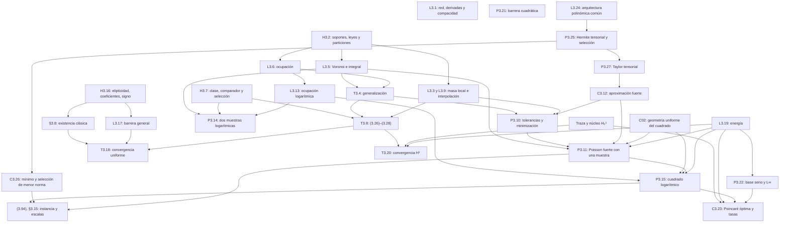

# Inventario formal del capítulo III

## Fuente y criterio

Fuente normativa de la etapa 17: `Tesis_PUCP/main.pdf` dentro de `Tesis_PUCP_Resumen_Conectores_20261108.zip`, SHA-256 `c6c612f7141c8c6ab5730fc0853b6d16222b97e5615e306f2e32191a49b686e0`. El capítulo ocupa las páginas impresas 30–135 (43–148 del PDF). El texto extraído de las 106 páginas coincide página por página con la revisión auditada de SHA-256 `139e14ba44af83e0a02e9bd767e8f213f6800e74afc24287fb12454bfa356d0f`. El archivo PDF suelto del mismo nombre que el ZIP tiene otro hash y queda fuera de la comparación. Los auxiliares LaTeX del ZIP se usan para ubicar etiquetas y comprobar fórmulas cuya extracción pierde superíndices o barras de clausura.

Base Lean `4ce560996873ebe701af34abeb30e04d590acaa6` de la PR #19, más los cambios explícitos de la etapa 18. Los nombres de Lean se citan en el espacio `TesisPINN` salvo indicación contraria. La dificultad mide la formalización restante, incluida la comparación de interfaces. Las prioridades A, B, C y D se refieren a dependencias imprescindibles, reutilización directa, infraestructura y clases concretas, respectivamente.

Estados: **E** equivalente en el alcance indicado de la fila, **R** demostrado con alcance o hipótesis más restrictivos, **P** parte demostrada, **F** interfaz declarada con obligaciones externas, **N** pendiente, **Bibl.** dependencia externa. En particular, **E** aplicado a una ecuación auxiliar no certifica su enunciado padre. Una hipótesis matemática se registra como premisa o interfaz, no como teorema pendiente de probar en general.

## Enunciados numerados

| ID | Resultado de la tesis | Página | Hipótesis | Dependencias | Declaración Lean | Estado | Dificultad | Prioridad |
|---|---|---:|---|---|---|---|---|---|
| L3.1 | Regularidad de la MLP, cotas uniformes de derivadas y precompacidad en $C^k(\overline U)$, con límite en la misma clase parametrizada | 33 | Arquitectura fija, (k'>k), activación $C^{k'}$, parámetros en bola euclidiana compacta, (U) acotado | Cap. II MLP, regla de la cadena y Faà di Bruno, compacidad y continuidad parámetro–función | — | N | Alta | C |
| H3.2 | Muestreo y geometría, con leyes, densidades positivas, particiones y cotas superiores de bolas cerradas | 43 | (U) acotado Lipschitz, $\Gamma\subseteq\partial U$ cerrado, leyes respecto a volumen y Hausdorff, i.i.d. internos e independencia mutua | Cap. I medidas, (3.4), ejemplo del cuadrado | `DatosMasa38`, `Muestreo38`, `DensidadInferior` | F, interfaz de masa 2/1 que omite hipótesis que su prueba no usa | Media | A |
| L3.3 | No degeneración de bolas abiertas, con constantes $c(2\sqrt d)^{-s}$ | 44 | H3.2, $d\ge2$, radio hasta $2\sqrt d\,\varepsilon_0$ | Celda de escala $r/(2\sqrt d)$ | `masa_bola_inferior_de_particiones`, `masa_bola_inferior_potencia` | R, $\sqrt 2$ y exponente de masa parametrizado | Baja | A |
| T3.4 | Generalización simultánea en evento de alta probabilidad, uniforme en candidatos. Caso separado (d=1) | 48 | H3.2, (\alpha\in(0,1]), pesos fijos, datos y operadores Hölder, radios admisibles | L3.5, L3.6, (3.5)–(3.12) | `objetivoCoberturaIntegral_de_hipotesis`, `cobertura_eventual_de_particiones_raiz` | P, cota determinista escalar 2D y cobertura con mayorante exponencial. Falta paquete finito exacto y caso 1D | Media | A |
| L3.5 | Cota integral determinista (3.13) a partir de proximidad a muestras | 51 | Cobertura cerrada, datos y operadores Hölder, (3.4), leyes concentradas y pérdida integrable | Voronoi finito, (3.14)–(3.17), integración | `objetivoCoberturaIntegral_de_hipotesis` | R, residuos escalares y exponentes de masa 2/1 | Media | A |
| L3.6 | Probabilidad de cobertura con masa mínima por celda, incluida escala de ocupación (t/m) | 58 | Ley de probabilidad concentrada, particiones medibles disjuntas módulo nulos, diámetro y masa mínima, muestras i.i.d. | Probabilidad exacta de celda vacía, Boole, $1-x\le e^{-x}$ | `medida_celdaVacia`, `medidaReal_falloOcupacion_le_exp`, `cardinal_por_masa_minima`, `ocupacion_implica_cobertura` | P, piezas genéricas demostradas, falta empacar toda la escala (t) y la cota binomial | Baja | A |
| H3.7 | Clases neuronales $C^{k,\alpha}(\overline U)$, operadores Hölder, comparadores exactos con seminormas uniformes y selección mensurable | 64 | (f,g) Hölder, clase por par muestral, evento común conull para la sucesión | (3.22)–(3.25), para instancia manufacturada L3.24/P3.25 | `CotasHolder`, `ComparadorExacto`, premisas de `teorema38_dim2` | F, clase abstracta y cotas Hölder elegidas; instancia neuronal pendiente | Alta | D |
| T3.8 | Tasa poblacional, convergencia uniforme y tasas de operadores, incluidas variante (d=1) y norma sobre $\overline U$ | 66 | H3.2/H3.7, selección de minimizadores globales, pesos iguales, crecimiento $m_r(n),m_b(n)\ge n$ eventual, comparabilidad $m_r=O(m_b^{d/(d-1)})$ | L3.3, T3.4, L3.9, minimalidad, Borel–Cantelli | `teorema38_dim2` | R, prueba integrada escalar 2D para prefijos, con identificación de la norma en la clausura descrita en auditoría | Alta | A |
| L3.9 | Interpolación Hölder–$L^2$, $\|v\|_\infty\le C(Q+Q^{2\alpha/(2\alpha+s)})$ | 70 | Probabilidad métrica, masa abierta inferior $c\rho^s$ hasta $\rho_0$, (v) acotada y Hölder | Bola truncada, punto próximo al máximo, (3.35) | `abs_le_holder_add_de_integral`, `supResiduo_le_radio_truncado`, `tasa_supResiduo_de_integral` | P, cotas a radio fijado y transferencia de tasa; falta enunciado global literal | Baja | B |
| P3.10 | Comparador aproximado y suboptimalidad. Cotas de regularidad, objetivo y población. Bajo tolerancias $O(a_m)$, mismas tasas casi seguras que T3.8 | 75–77 | H3.2, parte 1 de H3.7, selección mensurable, pesos iguales, (3.36)–(3.38), comparabilidad y (3.42) para tasa | T3.4, T3.8, L3.9, álgebra de mínimos | `minimizadorAproximado_iff_le_infimo`, `cotas_minimizador_aproximado`, `perdidaPoblacional_aproximada_bajo_cobertura`, `proposicion310_dim2` | R, integración casi segura para residuos escalares y exponentes de masa 2 y 1 | Verificado en 2D | A |
| P3.11 | Poisson 2D fuerte con una muestra interior. Cota de cobertura, tolerancias y pérdida $O(m^{-\alpha/2})$, error $H^1=O(m^{-\alpha/4})$ | 77 | $U=(-1,1)^2$, ley uniforme, clase de traza exacta, crecimiento de prefijos, comparador y candidato subóptimo | Geometría del cuadrado, L3.5/L3.6, P3.10, L3.19, (3.44)–(3.55) | Cota interior de `integral_residuo_le_cobertura` y `transferencia_energiaPoisson_ae` como ingredientes | P, falta cadena de una muestra y constantes | Media | A |
| C3.12 | Aproximación fuerte $C^{k,\alpha}$ a escala $\sqrt{a_m}$ implica tolerancia empírica (O(a_m)) y regularidad uniforme | 80 | Operadores lineales continuos hacia los espacios Hölder, solución exacta, candidatos admisibles y criterio (3.56) | P3.10/P3.11, normas de operadores y pesos fijos | — | N | Media | B |
| L3.13 | Radios logarítmicos y cobertura eventual con fallo $n^{1-\kappa}/(\kappa\log n)$ | 82 | $\kappa>2$, $n\ge3$, particiones con (D,c,s>0), prefijos i.i.d., umbrales geométricos | L3.6, $\exp(-\kappa\log n)=n^{-\kappa}$, series p, Borel–Cantelli | `medidaReal_falloOcupacion_le_exp`, `cobertura_eventual_casi_segura` | P, piezas sin la escala logarítmica | Baja | A |
| P3.14 | Generalización logarítmica de dos muestras y tasa de pérdida $O((\log m_r/m_r)^{2\alpha/d}+(\log m_b/m_b)^{2\alpha/(d-1)})$ | 83 | H3.2, $d\ge2$, radios válidos, H3.7 y mínimos para el nuevo peso, crecimiento eventual | L3.5, L3.13, (3.59)–(3.63) | `objetivoCoberturaIntegral_de_hipotesis` con radios libres, `factor_mul_peso_igual` | P, cota determinista 2D disponible; la tasa logarítmica queda pendiente | Media | A |
| P3.15 | Poisson fuerte logarítmico con $\alpha=1/2$, $\kappa=3$, radio $\sqrt{54\log m/m}$, pérdida $O((\log m/m)^{1/2})$, energía $O((\log m/m)^{1/4})$ | 86 | Cuadrado uniforme, una muestra interior, umbrales de validez, comparador y tolerancia $O(a_m^{\log,\mathrm{int}})$ | P3.11, L3.13, L3.19, (3.64)–(3.66) | `energia_cuadrado_uniforme`, `cota_norma_sin_superior` | P, ingredientes energéticos; falta pérdida logarítmica | Media | A |
| H3.16 | Elipticidad uniforme, simetría, coeficientes y derivadas con regularidad y cotas globales, esfera exterior y signo $\tilde c\le0$ | 91 | Operador en divergencia del Cap. I, $0<\alpha<1$ | Expansión a forma no divergente, existencia clásica | — | F en tesis, N como interfaz Lean | Media | C |
| L3.17 | Estabilidad uniforme $\|v\|_\infty\le\|v\rvert_{\partial U}\|_\infty+C_0\|\mathcal L v\|_\infty$ | 92 | (U) acotado, $v\in C^2(U)\cap C^0(\overline U)$, residuo acotado, coeficientes continuos acotados, elipticidad y $\tilde c\le0$ | Barrera exponencial, máximo débil y (3.67)–(3.68) | — | N | Alta | A |
| T3.18 | Convergencia del aproximante en $C^0(\overline U)$ y tasa dominada por el residuo interior | 96 | H3.16, problema clásico y $Gamma=\partial U$, candidatos clásicos, premisas de T3.8 | GT 6.13, T3.8, L3.17, orden de exponentes | Tasa de residuos de `teorema38_dim2` | P, falta el paso del residuo a la solución | Media | A |
| L3.19 | Energía de Poisson con constante $C_P\sqrt{1+C_P^2}$ | 98 | Dominio acotado Lipschitz en $\mathbb R^d$, $e\in H_0^1$, $\Delta e\in L^2$, constante de Poincaré dada | Green distribucional, densidad, Poincaré, Cauchy–Schwarz | `energia_sobolev_plano_volumen`, `energia_cuadrado_uniforme` | R, puente distribucional en 2D, con elección de constante admisible | Media | A |
| T3.20 | Convergencia y tasa $H^1$ para Poisson con traza exacta, más ruta alternativa por supremo | 100 | Dominio Lipschitz, $Gamma=\partial U$, solución exacta distribucional $H^1\cap C^0(\overline U)$, candidatos de la misma traza y laplaciano $L^2$, T3.8 | Teorema de trazas (1.4), L3.19, T3.8, densidad residual inferior | `teorema320_poisson_de_teorema38`, `teorema320_levantado_de_teorema38` | R, cuadrado con $\psi q$ o $G+\psi q$ suaves y premisa afín $H_0^1$ | Alta | C |
| P3.21 | Barrera cuadrática para Poisson, constante (1/2) del residuo supremo | 104 | Cuadrado, $v\in C^2(U)\cap C^0(\overline U)$; caso de interés con residuo acotado | Barrera $b=(2-x^2-y^2)/4$, máximo débil | — | N | Media | B |
| P3.22 | Representante continuo y control $L^2\to L^\infty$ por constante espectral $\le0.26404$ | 105 | Cuadrado, $e\in H_0^1$, $\Delta e\in L^2$ | Base seno tensorial, Parseval, Green, convergencia absoluta y uniforme, suma certificada | — | N | Alta | C |
| C3.23 | Poincaré óptima $\sqrt2/\pi$, constantes simultáneas y tasa logarítmica $H^1+L^\infty$ | 109 | Misma traza, residuo $L^2$ y, para tasa, P3.15 | P3.22, P3.15, L3.19, primera autofunción | `energia_cuadrado_uniforme` solo constante genérica | P | Alta | C |
| L3.24 | Arquitectura cuadrática común para toda clase polinómica, capas ocultas fijas y salida lineal variable | 113 | $m\ge1$, grado parcial máximo (D=4m-1), $N=(D+1)^2$, factor $\psi$ | Registros codificados, producto, generación de monomios y transporte sin saltos | `decodificar_registro`, `multiplicacion_cuadratica`, `factor_frontera` | P, identidades algebraicas; falta la red y sus cotas de arquitectura | Alta | D |
| P3.25 | Comparadores polinómicos de Hermite exactos para cualquier muestra, cota $C^3$ uniforme, selección boreliana y realización cuadrática | 116 | Problema manufacturado (3.84)–(3.85), $m\ge1$, muestras ordenadas en el cuadrado; coordenadas repetidas permitidas | L3.24, Hermite univariado multiplicidad 4, resto por contorno, producto tensorial, MVT, estratos borelianos | `psiGraph_mem_H01`, `psiCuadrado_cero_frontera` solo para factor | P, frontera; construcción de interpolante y de la clase pendiente | Alta | D |
| C3.26 | Existencia de mínimos para la clase polinómica y selección boreliana; cotas de minimizadores | 122 | Clase (3.87), cualquier muestra interior, (alpha=1/2), pesos positivos | P3.25, inyectividad sobre la clase, coercividad en coeficientes, regularización estrictamente convexa y límite | `regularidad_minimizador_le_comparador`, `perdidaEmpirica_le_regularidad_uniforme` solo una vez dado el mínimo | P | Alta | D |
| P3.27 | Taylor de (a), error $C^3$ univariado $O((N+1)^3 2^{-N})$, producto tensorial con $N_m=\lceil2\log_2 m\rceil$ y error $O((1+\log m)^3 m^{-2})$ | 127 | Función entera manufacturada, clase polinómica y (alpha=1/2) para ambos criterios de tolerancia | Cauchy en radio 2, series y Leibniz, (3.87), C3.12, pesos originales y logarítmicos | `psiCuadrado_cero_frontera` solo para factor | P, frontera genérica, resto y tasas pendientes | Alta | D |

## Ecuaciones numeradas

La matriz usa `3.x` precedido de **Ecu.** para distinguirlo del enunciado que tiene la misma numeración. Las ecuaciones (3.44)–(3.45) se leen en la p. 78 del PDF y carecen de etiqueta individual en el auxiliar LaTeX.

| ID | Resultado de la tesis | Página | Hipótesis | Dependencias | Declaración Lean | Estado | Dificultad | Prioridad |
|---|---|---:|---|---|---|---|---|---|
| Ecu. 3.1 | Problema abstracto L[u]=f en U y B[u]=g en Γ | 32 | Definición operativa de L y B | Cap. I/II | Operadores38 | F, operadores abstractos | Media | A |
| Ecu. 3.2 | Cota inductiva Mℓ,s sobre derivadas de cada capa | 34 | Parámetros acotados, activación suave | L3.1, cadena | — | N | Baja | B |
| Ecu. 3.3 | Cota de derivadas de la preactivación afín | 36 | Cota de pesos y capa anterior | L3.1, (3.2) | — | N | Baja | B |
| Ecu. 3.4 | Cotas de masa de bolas cerradas de ambos soportes | 43 | Radios hasta ε₀, exponentes d y d−1 | H3.2 | MasaBolaSuperior | E, como premisa paramétrica | Verificado | A |
| Ecu. 3.5 | Radios originales εr, εb de escala raíz | 48 | Tamaños positivos, constantes c positivas | L3.6 | escalaAuxiliarRaiz; radio_cobertura_potencia | R, 2D | Media | A |
| Ecu. 3.6 | Factor de cobertura C_m de máximo de dos masas | 48 | Radios (3.5) | L3.5 | factorCoberturaCuadrado | R, 2D | Media | A |
| Ecu. 3.7 | Pesos mínimos de regularización 3λε^(2α)/C_m | 49 | C_m positivo | (3.5), (3.6) | pesoCobertura | E, fórmula | Verificado | A |
| Ecu. 3.8 | Funcional empírico con pesos mínimos | 49 | Pérdida y regularizadores de operador | H3.2, (3.7) | ProblemaPINN.funcionalRegularizado | E, escalar con elección exacta | Verificado | A |
| Ecu. 3.9 | Constante C′ por seminormas de los datos | 49 | Datos Hölder | (3.5), (3.13) | tasa_de_cota_cobertura | P, cota alternativa en 2D | Media | A |
| Ecu. 3.10 | Probabilidad finita conjunta con términos binomiales | 49 | Particiones y muestras i.i.d. | L3.6, unión | medida_celdaVacia; falloOcupacion_le_escala_raiz | P, evento y mayorante exponencial | Media | A |
| Ecu. 3.11 | Pérdida poblacional dominada por C_m por objetivo y dos tasas | 49 | Cobertura y radios originales | L3.5, (3.5)–(3.9) | objetivoCoberturaIntegral_de_hipotesis | R, 2D con términos explícitos | Media | A |
| Ecu. 3.12 | Versión 1D con frontera determinista y solo regularización interior | 50 | Extremos disponibles, muestras interiores | L3.5/L3.6 en 1D | — | N | Media | A |
| Ecu. 3.13 | Cota integral de cobertura con errores de datos separados | 51 | Cobertura, masas e integrabilidad | L3.5, (3.14)–(3.17) | objetivoCoberturaIntegral_de_hipotesis | R, 2D escalar | Media | A |
| Ecu. 3.14 | Cuadrado de suma de tres términos acotado por tres veces suma de cuadrados | 53 | Escalares en Lean | Cauchy–Schwarz | cuadrado_suma_tres_le | E, escalares | Verificado | B |
| Ecu. 3.15 | Defecto puntual interior estimado desde vecino más próximo | 54 | Hölder de L y f | L3.5, (3.14) | residuo_puntual_en_celda | E, escalar | Verificado | B |
| Ecu. 3.16 | Defecto puntual de frontera estimado desde vecino | 55 | Hölder de B y g | L3.5, (3.14) | residuo_puntual_en_celda | E, escalar | Verificado | B |
| Ecu. 3.17 | Masa de celda de Voronoi interior ≤ C_r ε_r^d | 57 | Cobertura, centro en soporte | (3.4), Voronoi | medida_celdaVoronoi_le | E, exponente genérico | Verificado | A |
| Ecu. 3.18 | Ocupación de todas las celdas con fallo ≤ K(1−p)^m | 59 | Masa mínima p, muestras i.i.d. | L3.6, unión | medida_celdaVacia; medida_falloOcupacion_le_suma | P, ingredientes exactos | Media | A |
| Ecu. 3.19 | Elección t de ocupación, fallo ≤ (m/t)exp(−t) | 59 | 0<t≤m, escala de partición | L3.6, (3.18) | medidaReal_falloOcupacion_le_exp; cardinal_por_masa_minima | P, composición genérica pendiente | Media | A |
| Ecu. 3.20 | Número de celdas ≤ 1/$cε^s$ | 60 | Partición disjunta módulo nulos, masa mínima | H3.2, aditividad | cardinal_por_masa_minima | R, disjunción exacta | Media | A |
| Ecu. 3.21 | Condición de comparación de pesos admisibles con los mínimos | 63 | Pesos mínimos positivos | (3.7), selección de pesos | pesoInterior_le_igual; pesoFrontera_le_igual | P, elección igual | Media | A |
| Ecu. 3.22 | Funcional regularizado con dos seminormas cuadradas | 63 | Clase y operadores Hölder | H3.7, pérdida empírica | ProblemaPINN.funcionalRegularizado | E, escalar con seminormas exactas | Verificado | A |
| Ecu. 3.23 | Ambos pesos iguales al máximo de los pesos mínimos | 63 | C_m positivo | (3.7), (3.21) | pesoRegularizacionIgual | E, fórmula | Verificado | A |
| Ecu. 3.24 | Pérdida empírica nula del comparador | 64 | Admisibilidad, datos de entrenamiento | H3.7 | ProblemaPINN.ComparadorExacto | E, premisa | Verificado | A |
| Ecu. 3.25 | Seminormas Hölder uniformemente acotadas de comparadores | 64 | Clase y evento común, selección | H3.7 | Premisa de teorema38_dim2 | F, cotas elegidas | Media | A |
| Ecu. 3.26 | Tasa poblacional O$mr^(−α/d)$ | 66 | Cobertura y comparadores exactos | T3.4, T3.8 | tasa_poblacional_eventual_casi_segura; teorema38_dim2 | R, 2D escalar | Media | A |
| Ecu. 3.27 | Convergencia uniforme en clausura interior y en Γ | 66 | Hipótesis de T3.8 | L3.9, (3.26) | teorema38_dim2 | R, supremo sobre soporte, 2D | Media | A |
| Ecu. 3.28 | Tasas uniformes con exponentes −α²/[d(2α+d)] y −α²/[d(2α+d−1)] | 67 | Hipótesis de T3.8 | L3.9, (3.26) | teorema38_dim2 | R, 2D | Media | A |
| Ecu. 3.29 | Cota de regularidad del minimizador por la del comparador | 68 | Mínimo exacto, comparador exacto, a_m positivo | Minimalidad, (3.22)–(3.25) | ProblemaPINN.regularidad_minimizador_le_comparador | E, núcleo escalar | Verificado | A |
| Ecu. 3.30 | Pérdida empírica del minimizador ≤ a_m R* | 68 | Mismas premisas que (3.29) | Minimalidad | ProblemaPINN.perdidaEmpirica_le_regularidad_uniforme | E, núcleo escalar | Verificado | A |
| Ecu. 3.31 | Orden de C_m a_m en la tasa poblacional | 68 | Radios, pesos y comparabilidad de tamaños | (3.5)–(3.7), (3.23) | factor_mul_peso_igual; tasa_de_cota_cobertura | R, 2D | Media | A |
| Ecu. 3.32 | Normas L² de residuos en las leyes de muestreo tienden a cero | 70 | Pesos positivos y (3.26) | Pérdida poblacional | convergencia_y_tasas_uniformes_ae | P, argumento de integrales en la cadena, sin enunciado separado | Media | A |
| Ecu. 3.33 | Regularidad Hölder uniforme de ambos residuos | 70 | Regularidad de minimizadores y datos | (3.29), desigualdad triangular | holder_residuos_minimizador | E, núcleo escalar | Verificado | A |
| Ecu. 3.34 | Interpolación Hölder–L² en toda escala admisible | 71 | Masa local y v acotada Hölder | L3.9, (3.35) | supResiduo_le_radio_truncado | P | Baja | B |
| Ecu. 3.35 | Cota inferior de integral en bola de radio truncado según el supremo | 71 | Masa local y Hölder | L3.9 | abs_le_holder_add_de_integral | P, desigualdad relacionada | Baja | B |
| Ecu. 3.36 | Tolerancia empírica ε_m del comparador | 75 | Comparador admisible | P3.10 | Premisa de cotas_minimizador_aproximado | F | Media | A |
| Ecu. 3.37 | Regularidad del comparador ≤ R* | 75 | Comparador admisible | P3.10 | Premisa de cotas_minimizador_aproximado | F | Media | A |
| Ecu. 3.38 | Suboptimalidad δ_m respecto al ínfimo | 75 | Clase no vacía y objetivo acotado por abajo | P3.10 | ProblemaPINN.minimizadorAproximado_iff_le_infimo | E, equivalencia de representaciones | Verificado | B |
| Ecu. 3.39 | Regularidad del aproximado ≤ R*+(ε_m+δ_m)/a_m | 75 | a_m positivo, (3.36)–(3.38) | Minimalidad aproximada | ProblemaPINN.cotas_minimizador_aproximado | E, núcleo escalar | Verificado | B |
| Ecu. 3.40 | Objetivo regularizado ≤ a_m[R*+(ε_m+δ_m)/a_m] | 75 | Mismas premisas que (3.39) | Minimalidad aproximada | ProblemaPINN.cotas_minimizador_aproximado | E, núcleo escalar | Verificado | B |
| Ecu. 3.41 | Pérdida poblacional acotada con tolerancias | 75 | Cobertura, (3.36)–(3.38), pesos iguales | (3.13), (3.40) | perdidaPoblacional_aproximada_bajo_cobertura | R, 2D con términos de datos en radios | Media | A |
| Ecu. 3.42 | Criterio de tolerancias ε_m+δ_m≤K a_m eventual | 76 | Cota K determinista y peso original de (3.23) | P3.10 | Premisa eventual de `proposicion310_dim2` | E en la instancia 2D | Verificado | A |
| Ecu. 3.43 | Tasa poblacional casi segura bajo tolerancias, seguida de (3.27)–(3.28) | 76–77 | Hipótesis de P3.10 y (3.42) | Borel–Cantelli, (3.31), (3.41), L3.9 | `proposicion310_dim2` | R, demostrado en 2D escalar | Verificado en 2D | A |
| Ecu. 3.44 | Pérdidas interior empírica y poblacional E_m, E | 78 | Poisson, muestra interior, ley uniforme | P3.11 | perdidaEmpiricaInterior, término interior de perdidaPoblacional | P, instanciación de una muestra pendiente | Media | A |
| Ecu. 3.45 | Regularizador de Δh y objetivo J_m de una muestra | 78 | Seminorma Hölder exacta, peso interior | P3.11 | ProblemaPINN.regularidadInterior | P | Media | A |
| Ecu. 3.46 | Radio interior original 3√2 m^(−1/4) | 78 | Cuadrado, c_r=1/9, radio admisible | Geometría, (3.5) | escalaAuxiliarRaiz | P, constante de la instancia pendiente | Media | A |
| Ecu. 3.47 | Factor interior 27π√m/2 | 78 | c_r=1/9, C_r=π/4 | (3.46), L3.5 | — | N | Media | A |
| Ecu. 3.48 | Peso interior original con α general | 78 | C_m interior positivo | (3.46), (3.47) | pesoCobertura | P, instancia | Media | A |
| Ecu. 3.49 | Probabilidad de cobertura interior | 78 | Muestras i.i.d., radios admisibles | L3.6, (3.46) | falloOcupacion_le_escala_raiz | P | Media | A |
| Ecu. 3.50 | Cota de E en función de J_m y datos | 78 | Evento de cobertura interior | L3.5, (3.44)–(3.48) | integral_residuo_le_cobertura | P | Media | A |
| Ecu. 3.51 | Tolerancias η_m y δ_m, y regularidad R* | 78 | Clase de Dirichlet exacto | P3.11 | Suboptimalidad de ComparadoresAproximados | F, para funcional de dos términos | Media | A |
| Ecu. 3.52 | Control de regularidad del minimizador interior | 79 | a_m interior positivo | (3.51), (3.39) | — | N para una muestra | Media | A |
| Ecu. 3.53 | Cota de pérdida poblacional interior aproximada | 79 | Cobertura y (3.51) | (3.50), (3.52) | — | N | Media | A |
| Ecu. 3.54 | Peso explícito 2√2 m^(−3/4)/(3π) | 79 | α=1/2 | (3.46)–(3.48) | — | N | Media | A |
| Ecu. 3.55 | Error energético O$m^(−α/4)$ a.s. de una muestra | 79 | Cota de tolerancias y Dirichlet exacto | P3.11, L3.19 | transferencia_energiaPoisson_ae | P, mecanismo raíz | Media | A |
| Ecu. 3.56 | Criterio de aproximación fuerte ≤ A√a_m | 80 | Continuidad lineal de operadores, admisibilidad | C3.12 | — | N | Baja | B |
| Ecu. 3.57 | Escala auxiliar y radio logarítmicos | 82 | κ>2, n≥3, validez geométrica | L3.13, L3.6 | — | N | Baja | B |
| Ecu. 3.58 | Fallo n^(1−κ)/(κ log n) | 82 | Muestras i.i.d. y particiones | (3.57), L3.6 | medidaReal_falloOcupacion_le_exp | P, sin escala logarítmica | Baja | B |
| Ecu. 3.59 | Radios logarítmicos interior y frontera | 84 | d≥2, validez de particiones | L3.13 | — | N | Media | A |
| Ecu. 3.60 | Constantes y pesos iguales logarítmicos | 84 | Radios positivos | (3.59), (3.23) | factor_mul_peso_igual | P | Media | A |
| Ecu. 3.61 | Probabilidad conjunta de cobertura logarítmica | 84 | Hipótesis de P3.14 | L3.13, unión | — | N | Media | A |
| Ecu. 3.62 | Cota poblacional logarítmica simultánea | 84 | Cobertura y regularizadores de operador | L3.5, (3.60) | objetivoCoberturaIntegral_de_hipotesis | P, cota genérica 2D con radios libres | Media | A |
| Ecu. 3.63 | Tasa poblacional logarítmica de dos muestras | 84 | Comparadores y mínimos para nuevo peso | P3.14, Borel–Cantelli | — | N | Media | A |
| Ecu. 3.64 | Radio, factor y peso logarítmicos explícitos del cuadrado | 86 | κ=3, α=1/2, m suficientemente grande | L3.13, geometría | — | N | Media | A |
| Ecu. 3.65 | Cota logarítmica explícita de pérdida interior | 87 | Criterio de tolerancias y cobertura | P3.15, (3.64) | — | N | Media | A |
| Ecu. 3.66 | Tasa H¹ logarítmica | 87 | P3.15, Dirichlet fuerte y ley uniforme | (3.65), L3.19 | energia_cuadrado_uniforme | P, falta premisa de tasa logarítmica probada | Media | A |
| Ecu. 3.67 | Cota suprema para operador elíptico general | 92 | Elipticidad, signo, cotas, residuo acotado | L3.17, máximo débil | — | N | Alta | C |
| Ecu. 3.68 | Cota suprema del error por defectos interior y frontera | 93 | Solución y candidato clásicos | L3.17, (3.67) | — | N | Alta | C |
| Ecu. 3.69 | Convergencia uniforme de aproximantes | 96 | Hipótesis de T3.18 | L3.17, (3.27) | teorema38_dim2 solo operadores | P | Alta | C |
| Ecu. 3.70 | Tasa uniforme del error dominada por el interior | 96 | Hipótesis de T3.18 | L3.17, (3.28) | teorema38_dim2 solo operadores | P | Alta | C |
| Ecu. 3.71 | Cota energética por Poincaré y laplaciano distribucional | 98 | e∈H₀¹, Δe∈L² | L3.19 | energia_sobolev_plano_volumen; energia_cuadrado_uniforme | R, 2D | Media | A |
| Ecu. 3.72 | Convergencia H¹ a.s. | 101 | Hipótesis de T3.20 | L3.19, T3.8 | Dos puentes integrados de 3.20 | R, cuadrado y candidatos suaves | Media | A |
| Ecu. 3.73 | Tasa H¹ O$mr^(−α/(2d))$ | 101 | Hipótesis de (3.72) y densidad inferior | (3.26), (3.74) | Dos puentes integrados de 3.20 | R, cuadrado y candidatos suaves | Media | A |
| Ecu. 3.74 | Cota H¹ por ‖f−Δh‖₂ | 101 | Misma traza y laplacianos L² | L3.19, núcleo de traza | estimacion_uniforme_psi_solucion_exacta; energia_de_perdidaLevantada | R | Media | A |
| Ecu. 3.75 | Tasa H¹ alternativa vía norma suprema | 102 | Hipótesis de T3.20 | Volumen finito, (3.28), (3.74) | — | N como composición | Media | A |
| Ecu. 3.76 | Constante 1/2 de la barrera cuadrática | 104 | Cuadrado, v clásica y continua hasta frontera | P3.21, máximo débil | — | N | Alta | C |
| Ecu. 3.77 | Constante espectral de L² a L∞ y cota decimal | 105 | Cuadrado, traza nula, residuo L² | P3.22, (3.78)–(3.79) | — | N | Alta | C |
| Ecu. 3.78 | Parseval para coeficientes del residuo en base seno | 106 | L² sobre el cuadrado | P3.22, completitud de base | — | N | Alta | C |
| Ecu. 3.79 | Identidad débil que relaciona coeficientes por λ_jk | 106 | e∈H₀¹, Δe∈L², autofunción seno | Green y (3.78) | green_por_densidad como ingrediente | P | Alta | C |
| Ecu. 3.80 | Constante de Poincaré óptima √2/π | 109 | Cuadrado, Dirichlet | Primera autofrecuencia y expansión | — | N | Alta | C |
| Ecu. 3.81 | Constante explícita de energía con Poincaré óptima | 109 | Misma traza, Δe∈L² | (3.71), (3.80) | energia_cuadrado_uniforme con constante genérica | P | Alta | C |
| Ecu. 3.82 | Control L∞ por 0.26404 veces el residuo | 109 | Mismas premisas de (3.81) | P3.22 | — | N | Alta | C |
| Ecu. 3.83 | Tasa simultánea H¹+L∞ O$(log m/m)^(1/4)$ | 109 | Hipótesis de P3.15 | (3.65), (3.81)–(3.82) | — | N | Media | A |
| Ecu. 3.84 | Solución seno manufacturada y fuente −2π²u* | 111 | Cuadrado, dato homogéneo | Derivación clásica, signos | laplacianoClásico genérico | P, instancia pendiente | Alta | D |
| Ecu. 3.85 | Cociente a(t), valores removibles y extensión entera | 111 | Ceros simples ±1 | L’Hôpital o holomorfía removible | — | N | Alta | D |
| Ecu. 3.86 | Multiplicación exacta con dos neuronas cuadráticas | 112 | Entradas reales y salida lineal | Identidad de cuadrados | multiplicacion_cuadratica | E para identidad, P para representación MLP | Verificado | D |
| Ecu. 3.87 | Clase determinista ψp de grados parciales ≤4m−1 | 116 | m≥1 | L3.24, P3.25 | ψ suave como factor | P | Alta | D |
| Ecu. 3.88 | Interpolación exacta de residuo y frontera; cota C³ uniforme | 116 | Cualquier muestra ordenada | P3.25, Hermite, (3.89)–(3.90) | psiCuadrado_cero_frontera solo frontera | P | Alta | D |
| Ecu. 3.89 | Resto de Hermite por integral de contorno | 120 | Nodos en intervalo, multiplicidad 4, a entera | Cauchy y divisibilidad | — | N | Alta | D |
| Ecu. 3.90 | Cota C³ del resto sin separación de nodos | 121 | Contorno fijo con radio de control | P3.25, (3.89), derivación bajo integral | — | N | Alta | D |
| Ecu. 3.91 | Cotas de regularidad y pérdida de los mínimos construidos | 123 | Existencia y comparador exacto | C3.26, (3.29)–(3.30) | ProblemaPINN.regularidad_minimizador_le_comparador | P, falta construcción del mínimo | Alta | D |
| Ecu. 3.92 | Resto C³ de Taylor ≤ C(1+N)³ 2^(−N) | 127 | a entera, disco de radio 2 | Cauchy, series diferenciadas | — | N | Alta | D |
| Ecu. 3.93 | Resto C³ 2D ≤ C′(1+log m)³m^(−2) | 127 | N_m=⌈2log₂m⌉, m≥2 | (3.92), Leibniz, factorización | — | N | Alta | D |
| Ecu. 3.94 | Tasas de la clase manufacturada con Dirichlet fuerte | 130 | Comparadores y mínimos construidos, cobertura interior | P3.11, P3.15, P3.25, C3.26 | Puente energético como ingrediente | P | Alta | D |

## Definiciones, observaciones y construcciones sin número propio

Los siguientes bloques agrupan definiciones y pasos contiguos de una misma demostración. Se excluyen ejemplos experimentales sin afirmación matemática y referencias históricas que no se usan como premisas. Las identidades numéricas de §3.15 se incluyen por su papel en la interpretación de las cotas.

| ID | Resultado de la tesis | Página | Hipótesis | Dependencias | Declaración Lean | Estado | Dificultad | Prioridad |
|---|---|---:|---|---|---|---|---|---|
| D01 | Residuos interior y de frontera, medidas empíricas, pérdidas ponderadas y funcional regularizado | 30–33 | Operadores, datos y pesos positivos | Cap. I, §2.3, Ecu. 3.1, 3.8, 3.22 | `ProblemaPINN`, `Operadores38` | E para el escalar parametrizado, F para una clase de redes | Baja | A |
| C01 | Diferenciar la MLP por capas. Entrada identidad, derivada afín, fórmula por particiones de Faà di Bruno y telescopado de productos | 33–42 | Activación suficientemente suave, arquitectura fija, parámetros y entradas acotados | L3.1, Ecu. 3.2–3.3 | — | N | Alta | C |
| O01 | Equicontinuidad en la clausura a partir de cotas de derivadas en una caja y compacidad de la imagen en C^k; la sola densidad en C⁰ es insuficiente | 33, 38–42, 65 | Segmentos en caja convexa para el primer paso; bola compacta de parámetros para el segundo | L3.1, MVT, continuidad parámetro–función | — | N | Alta | C |
| C02 | Cuadrícula semiabierta de lado 2/⌈2/ε⌉, medida uniforme de área 1/4 y longitud 1/8, constantes c_r=1/9, C_r=π/4, c_b=1/12, C_b=1, ε₀=1 | 45–47 | Cuadrado abierto, frontera completa, vértices sin masa | H3.2, longitud de intersección con los cuatro lados, área de disco | `cuadrado_abierto`, `cuadrado_acotado` | P, geometría de masa por demostrar | Media | A |
| O02 | Masa local inferior como consecuencia de las particiones; distinción entre muestreo geométrico y existencia de comparadores | 44–47 | H3.2, masa mínima | L3.3, H3.7 | `masa_bola_inferior_de_particiones` | R, caso de diámetro √2 | Baja | A |
| C03 | Celdas de Voronoi medibles con desempate por índice mínimo, sumas de masas y valores de residuo | 52–58 | Lista finita no vacía, distancias continuas; se permiten repeticiones | L3.5, particiones y cotas cerradas | `celdaVoronoi_cover`, `celdaVoronoi_pairwise`, `celdaVoronoi_measurable`, `suma_masas_celdas` | E para la partición | Verificado | A |
| C04 | Celdas vacías, cota de unión, ocupación implica cobertura; eventos para prefijos y fallos sumables | 58–62, 68–70 | i.i.d., masa mínima, diámetros y crecimiento | L3.6, Borel–Cantelli | `medida_celdaVacia`, `ocupacion_eventual_casi_segura`, `cobertura_eventual_de_particiones_raiz` | E para piezas y escala raíz | Baja | A |
| C05 | Frontera en 1D como conjunto de extremos disponibles y término empírico exacto de frontera | 44, 50–51, 61–62, 72–73 | Intervalo y observación determinista en los extremos | T3.4, T3.8, dos pesos positivos | — | N | Media | A |
| O03 | Regularizar el operador o su residuo puede cambiar el mínimo. La condición de pesos (3.21) no controla su cociente; para d=2, mr=mb, el cociente mínimo crece como n^(α/2) | 48–51, 63, 73–74 | Datos Hölder, escalas originales | Ecu. 3.5–3.9, 3.21–3.23 | `pesoRegularizacionIgual`, `factor_mul_peso_igual` | P, falta contraejemplo de cociente | Baja | B |
| O04 | Comparadores simultáneos en un evento común, cotas deterministas o dependientes de la realización, caso trivial si u* pertenece a toda clase | 64–65 | Interpolación, selección mensurable y control Hölder | H3.7, T3.8 | `teorema38_dim2` recibe la formulación conull | F | Media | A |
| O05 | Integrabilidad, continuidad uniforme hasta la clausura, norma suprema frente al control de pérdida y exponente de frontera distinto del interior | 70–74 | Leyes concentradas, dominios acotados y Hölder, pesos positivos | T3.8, L3.9, densidad de U en su clausura | `poblacionIntegrable_de_holder_acotado`, `supResiduo`, `measurable_supResiduo_de_denso` | P, falta empaquetar extensión en C⁰(Ū) | Media | A |
| O06 | Pérdida empírica y regularizador discreto de pares no certifican tolerancia del funcional continuo. La tasa no es respecto del número de iteraciones del optimizador | 73–76, 89, 102–103, 130–135 | Definición de objetivo y supuestos de suboptimalidad | P3.10, P3.15, §3.15 | `EsMinimizadorAproximado` expresa la premisa correcta | F, sin certificación experimental | — | D |
| C06 | Criterio fuerte de comparadores en la especialización interior. Derivadas hasta orden k y continuidad de operadores implican pérdidas cuadráticas pequeñas uniformemente en nodos | 80–81 | Normas de operador, dato exacto y cota O(√a_m) | C3.12, P3.10/P3.11 | — | N | Media | B |
| C07 | Validez de radio logarítmico para m≥310, serie de fallos, mejora del exponente con nuevo peso y relación de escalas de tolerancia | 82–90 | κ=3 en el cuadrado y α=1/2 para constantes, κ>2 en general | L3.13–P3.15, logaritmos y p-series | — | N para especialización logarítmica | Media | A |
| E01 | Existencia y unicidad clásica interior C^{2,α}_loc y continua hasta frontera por esfera exterior, sin regularidad global C^{2,α} | 90–92 | H3.16, g continuo, α∈(0,1), signo de orden cero | Gilbarg–Trudinger 6.13. 6.14 se distingue y no se usa | — | Bibl., equivalencia en bibliotecas por comprobar | Alta | C |
| C08 | Expansión a forma no divergente y cotas de deriva. Barrera exponencial con λ₀ y sup de la deriva; máximo débil sobre ambos signos | 91–96 | H3.16 para coeficientes; L3.17 solo requiere elipticidad, signo y cotas | Regla del producto, compacidad y principio máximo débil | — | N | Alta | A |
| O07 | Esfera exterior para existencia, estimación de estabilidad independiente de ella. Corrección de signo y comparación de exponentes de estabilidad uniforme y energética | 95–98, 102–104 | Solución dada para estabilidad, L=Δ para energía, L=−Δ cambia simultáneamente el dato | L3.17–T3.20 | Signos en `laplaciano_error_psi_solucion_exacta`; resto pendiente | P | Media | A |
| C09 | Green por densidad, caso gradiente cero, normalización de norma H¹, igualdad de trazas y comparación ponderada con densidad inferior | 98–103 | $H_0^1$, residuo L², densidad inferior; dominio Lipschitz para traza | L3.19, T3.20, teorema (1.4) | `green_por_densidad`, `norma_sobolev_cuadratica`, `cota_norma_sin_superior` | P, falta traza y dimensión general | Alta | A |
| C10 | Base seno tensorial, autofrecuencias π²(j²+k²)/4, serie uniforme, agrupación por max(j,k) y cola ≤N⁻² | 105–110 | Cuadrado, residuo L² y traza nula | P3.22, Parseval, Cauchy–Schwarz, prueba M | — | N | Alta | C |
| C11 | Factorización u*=ψa(x)a(y), nodos coordenados distintos, multiplicidad 4, evaluación de jets e inyectividad por divisibilidad | 111, 116–119 | m≥1, a entera y nodos de la muestra en intervalo | Ecu. 3.84–3.88, rango–nulidad | Frontera en `psiCuadrado_cero_frontera` | P | Alta | D |
| C12 | Codificación E(v)=((v+1)²,(v−1)²), producto de registros, transporte de variables y salida que recupera todos los monomios de ψp; red específica del producto tensorial | 112–116, 121–122 | Activación cuadrática y salida lineal, sin saltos | L3.24, P3.25, Ecu. 3.86 | `decodificar_registro`, `multiplicacion_cuadratica` | P, no existe representación Lean de las capas de la tesis | Alta | D |
| C13 | Hermite por sistema de Vandermonde confluente, estratos de colisiones de coordenadas, contorno fijo, derivación de resto y control C³ independiente de separación; paso a seminorma Hölder del laplaciano | 116–122 | Nodos posiblemente repetidos en la muestra original; distintas coordenadas agrupadas; (a) entera | P3.25, Ecu. 3.89–3.90, MVT | — | N | Alta | D |
| C14 | Positividad de Q_m por nulidad del laplaciano y unicidad Dirichlet; mínimo en esfera, coercividad, mínimo de menor norma como límite de minimizadores regularizados y selección boreliana | 122–126 | Clase finita dimensional, muestra no vacía, a_m>0 | C3.26, P3.25, máximo débil o energía, convexidad y compacidad | `ProblemaPINN.EsMinimizadorGlobal` solo interfaz | N para existencia y selección | Alta | D |
| C15 | Estimación de coeficientes por Cauchy, derivación término a término hasta orden tres, cola polinomial-geométrica, producto tensorial y comparación con ambas escalas de tolerancia | 127–130 | Función entera, contorno de radio 2, $N_m=\lceil2\log_2 m\rceil$ | P3.27, Ecu. 3.92–3.93, C3.12 | — | N | Alta | D |
| O08 | Diferencia entre Hermite exacto y Taylor sin nodos; tasa asintótica para la familia fabricada y elección correspondiente del objetivo. Alcance de comprobaciones computacionales | 129–132 | Comparadores, mínimos y ocupación de la misma muestra | P3.11, P3.15, L3.24–P3.27 | — | N para la instancia integrada | Alta | D |
| C16 | Constantes exactas del cuadrado para escalas original y logarítmica; cocientes de objetivos, potencias a m=10⁴ y cotas inferiores de los sumandos conocidos de los mayorantes | 132–135 | α=1/2, ley uniforme, fuente seno y tamaños indicados | Ecu. 3.46–3.54, 3.64–3.65; evaluación del cociente Hölder en puntos concretos | — | N para fórmulas y estimaciones certificadas. Las tablas de entrenamiento se registran como datos | Baja | B |

## Dependencias externas y obligaciones de biblioteca

| Dependencia externa | Uso | Biblioteca fijada o trabajo por hacer |
|---|---|---|
| Composición y derivación iterada, MVT, Faà di Bruno, compacidad de bolas y convergencia en normas de derivadas | L3.1, C3.12, P3.25/P3.27 | Mathlib dispone de `ContDiff`, derivadas iteradas y compacidad finita dimensional. Falta identificar una representación uniforme de jets y de la norma sobre la clausura. |
| Medidas, soporte, i.i.d., integración, sumabilidad y Borel–Cantelli | H3.2–T3.8, P3.10–P3.15 | Mathlib, `iIndepFun`, `ae_eventually_notMem`, integrales paramétricas. Se usan directamente en módulos verificados. |
| Existencia clásica Gilbarg–Trudinger 6.13 y principio máximo débil | §3.8, L3.17, T3.18, P3.21, C3.26 | No se atribuye a las bibliotecas un teorema equivalente sin comprobarlo. L3.17 admite reconstrucción mediante barrera y cálculo en máximo interior; existencia es una obligación separada. |
| Teorema de trazas y núcleo H₀¹ para dominios Lipschitz, (1.4) | T3.20, C3.23 | Falta el puente para el `H1Graph.H01` utilizado. La clausura de grafos y la identificación del gradiente ya vienen de EllipticPDE. |
| Poincaré, distribuciones y Green, normas Sobolev | L3.19 y T3.20 | EllipticPDE `poincare_H01_of_bounded`, `H01_le_W12`, `H1Graph.norm_sq_eq`; Mathlib `Distribution.ofFun`. Green se demuestra por densidad en el repositorio. |
| Fourier seno en intervalo y producto tensorial, bases de Hilbert, prueba M | P3.22, C3.23 | Parseval, espacios de Hilbert y series de Mathlib son candidatos. Construir y comprobar completitud de la base seno específica y normas derivadas es una obligación. |
| Singularidades removibles, Cauchy y coeficientes, series normalmente convergentes | P3.25/P3.27 | Teoría compleja de Mathlib es candidata. Requiere verificar normalización del contorno, anulación de polos, unicidad y diferenciación uniforme del resto. |
| Rango–nulidad, multiplicidad de raíces, inversa de matriz, compacidad/convexidad y límite de selectores | P3.25, C3.26 | Álgebra lineal, polinomios y topología de Mathlib. Hay que construir el selector boreliano mediante estratos y el límite regularizado; no basta la existencia de un mínimo por muestra. |

## Orden lógico y mapa

Las flechas de C3.12 hacia P3.10/P3.11 suministran la **instanciación** de las tolerancias, sin usar la conclusión probabilística para demostrarlas. P3.27 verifica el criterio de C3.12 mediante una cota independiente de las muestras. L3.1 y P3.21 son ramas independientes de las demostraciones integradas. P3.21 puede reutilizar el principio máximo de L3.17 al nivel de biblioteca, sin usar su cota exponencial.

1. **A.** Con P3.10 integrado en 2D, especializar L3.6 a radios logarítmicos para L3.13. Para P3.11, construir C02 y separar la interfaz interior. La generalización de exponentes y la variante unidimensional se mantienen como obligaciones separadas.
2. **A/B.** Introducir la escala logarítmica en L3.13 y transferir a P3.14/P3.15. Formalizar el criterio fuerte C3.12, usando las cotas de operador en espacios funcionales precisos. L3.17 y P3.21 permiten una ruta de estabilidad independiente de Fourier.
3. **C.** Generalizar energía y preparar la traza y la base seno. Separar el uso de existencia clásica en T3.18 de la estabilidad para una solución dada. Descargar el cálculo de la constante numérica de P3.22 antes de reclamar C3.23.
4. **D.** Definir polinomios y jets del manufacturado. Formalizar primero la extensión entera, Hermite univariado y la cola de Taylor como obligaciones independientes. Después ensamblar los productos tensoriales, realizar la arquitectura y demostrar selección y coercividad en coeficientes.

Para una aplicación concreta, los datos de masa y el operador, la pertenencia a la clase, las selecciones mensurables y su minimalidad son obligaciones de instanciación. En P3.25/C3.26 son además conclusiones matemáticas propias de la familia manufacturada. Las hipótesis de traza, densidad y tolerancias no se reemplazan por identidades o axiomas. El [estado central](ESTADO_FORMALIZACION_CAPITULO_III.md) registra qué declaraciones de cada etapa han sido verificadas.
